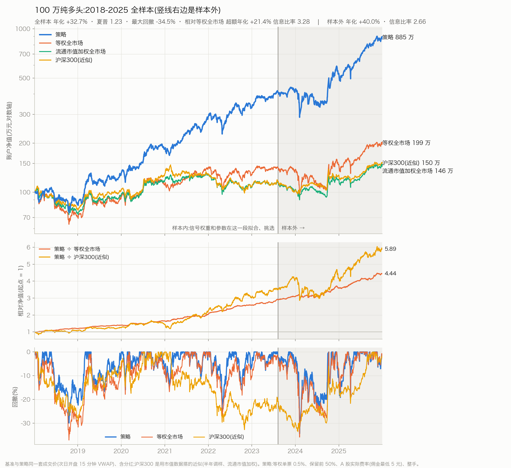
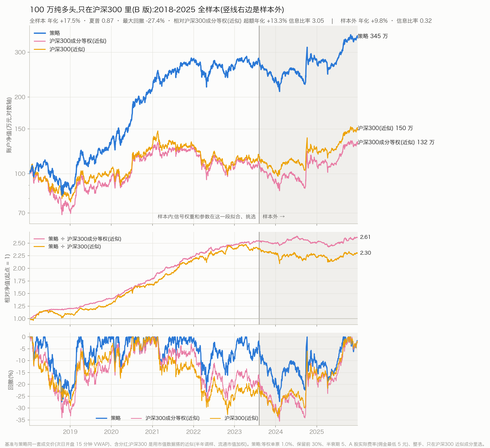

# 可交易回测:从理想权重到 100 万真账户

> 活文档,写法同 `docs/选因子与合成.md`:记录每一步为什么这么做、哪个数字把判断掰回来。
> 新证据往后追加,不删旧判断。
> 最后更新:2026-10-02(§10 剔除买不进的标签、§11 多空搬到纯多头、§12 全样本 100 万净值、§13 只在沪深300 里)。
> 代码:`scripts/tradable_backtest.py`(`prepare` / `run` / `sweep`)、`scripts/build_champion.py`、
> `scripts/ls_anatomy.py`、`scripts/signal_curve.py`、`scripts/long_side_fit.py`,
> 标签开关 `Label(buyable=True)` 在 `src/alphacube/label.py` + `src/alphacube/tradability.py`;测试同名。
>
> **§2~§9 用的是原冠军(原标签拟合);§10 起换成剔除封板标签重新拟合的新冠军,现在以 §10 为准。**

**口径**:冠军信号 `_bench/champion_signal.npy`(两层合成,族内 ridge x 族间 lstsq)。测试段起点
2023-08-08 放入 **100 万元**,复利滚到 2025-12-31(581 个交易日)。基准 = 等权全市场(不计成本)。
**参数一律在训练段选**(训练段按"资金恒定 100 万"跑,免得前几年的盈亏把资金规模带偏),测试段只报数。
费用两套:

- 项目口径:单边 15bp;
- A 股实际费率:佣金万 2.5(**每笔最低 5 元**)+ 卖出印花税(2023-08-28 起万 5,之前千 1)
  + 过户费十万分之一 + 滑点 5bp。100 万分到几百只、每笔几千元时,最低佣金让它**比 15bp 还贵**。

---

## 1. 真账户回测器做了什么

- **成交时点**:决策日 t 收盘后出信号,t+1 开盘 15 分钟 VWAP 成交,持有到 t+2 同一时点 —— 和标签
  `open_vwap15` 同口径。
- **记账**:按"后复权单位"记,除权除息市值不跳;股数用**不复权**价(ΣAmt/ΣVolume)判断。
- **交易单位**:主板/创业板 100 股一手;科创板单笔 >= 200 股、之后按 1 股递增;清仓允许卖零股;
  已有持仓的增减量不够一笔就不动(现金分红在后复权记账下会让股数带小数尾巴,不能为了尾巴卖掉一整手)。
- **买不进、卖不出**:开盘 15 分钟封涨停的买不进,封跌停的卖不出。"封死"指窗口最低价都在涨停价附近;
  一字板且离昨收超过 4.5% 也算,用来兜 ST。停牌不能交易,按最后价格估值;单笔不超过开盘 15 分钟成交量的 10%。
- **上市不足 60 天不买**:上市日按生命周期状态算,不用"第一个有价格的日子"(那会把 2018 年初恰好停牌的
  老股当成次新股)。先剔掉再排名,不占候选池名额。
- **科创板开盘价补齐**:见 §3。

## 2. 第一轮:从 +1.92 到 +1.66

| 步骤(测试段) | 超额夏普 | 备注 |
|---|---|---|
| 原网格:前 20%·exp1·hl5,权重口径,单边 15bp | +1.92 | 复现一字不差 |
| 换成真账户记账(净值复利、持仓随价漂移) | +1.93 | |
| 补齐科创板缺失的开盘价(基准同步补齐) | +1.98 | 停牌挂账 4.8% -> 0.1% |
| 涨跌停买卖不了 + 成交量上限 10% | +1.79 | |
| 把前 20% 的权重直接取整成整手 | **−0.03** | 1000 只每只 1000 元,一半现金买不进 |
| 用户目标(greedy),cap/hl 训练段选(0.2%·hl10) | +1.81 | |
| 再剔除上市不足 60 天(仍是 0.2%·hl10) | +1.81 | |
| 换成 A 股实际费率,cap/hl 重选(0.5%·hl10) | **+1.66** | 一年费用 4.6% |

## 3. 三个数据问题(影响不止回测,都还没修)

> 2026-10-01 下午:第 2 条(标签含买不进的收益)已修,见 §10;第 1、3 条还在。

1. **科创板分钟 Vwap 大面积缺失**。科创板在正常交易的股票日里,标签价算不出来的比例:训练段 17.1%、
   测试段 14.4%;主板和创业板只有 0.0%~0.1%。原因是开盘 15 分钟每分钟都有成交,但 Vwap 字段常常
   只剩两三分钟有值,而标签要求至少 5 分钟。复权因子一天之内每分钟都一样(实测 Vwap/(Amt/Vol) 恒为
   6.8897),所以回测里用 不复权 VWAP15 x 当天复权因子 补齐(`fill_prices`)。**标签本身仍缺着**,
   约占全部标签的 1.8%,挖因子和训练都受影响。
2. **标签里有买不进的收益**,合成权重在训练段学会了追它们。训练段(hl5)信号前 22 只:

   | | 次日封涨停 | 上市 < 60 天 | 日均超额:全部 | 去掉封板 | 再去掉次新 |
   |---|---|---|---|---|---|
   | 训练 前 22 | 12.1% | 52.7% | +62.9bp | **−33.6bp** | −0.0bp |
   | 训练 前 200 | 1.5% | 8.2% | +15.7bp | +5.3bp | +9.4bp |
   | 测试 前 22 | 2.5% | 2.9% | +14.7bp | −0.4bp | +0.3bp |
   | 测试 前 200 | 0.4% | 0.6% | +10.5bp | +8.3bp | +8.5bp |

   2018~2021 年新股上市连续一字板,标签照样记 +10%;开板能买进时正好接在山顶。2023 年主板注册制
   以后这种票基本消失,所以测试段只受轻伤。这也是训练段"越集中越差"(cap 5% 训练段 −3.3)的主因。
3. **立方体里没有 ST 标记**。只能靠"开盘一字板"间接认出 ST 封死的那些天,ST 股本身没法整体剔除。

## 4. 目标函数、单票上限、整手

- 用户目标 `max Σ w_i·exp(MinMax(signal_i))`,s.t. 整手、`w_i <= cap`。exp(MinMax) 是信号的单调变换、
  而且恒 >= 1,所以**最优解就是"按信号降序,每只买到 cap,钱用完为止"**。exp/MinMax 只决定次序,
  持几只完全由 cap 决定(约 1/cap 只)。也因为每只得分都 >= 1,目标函数会把零钱塞进任何一只票,
  所以只在信号前 20% 里分配。
- **单票上限**:训练段在 0.2%~0.5% 最好(200~600 只)。越集中越差,和"弱而广"的信号一致。
  无上限 = 全仓一只票,超额回撤(累加口径)−74% 到 −235%。**cap 能堵住 §5.5 里 exp5/softmax 的退化**。
- **整手**:用 greedy 分配时,100 万下整手基本不伤收益。cap 0.2% 时整手 +1.81、可以买零股 +1.72;
  整手略高是因为被迫偏向低价股(cap 0.5% 时持仓均价 9.7 元 vs 16.7 元)并多持了二十几只,算测试段运气,
  不是整手的功劳。但 cap 0.1%(每只 1000 元)时一半现金买不进,结果为 0。

## 5. 信号强度和次日收益是驼峰形,不是越强越好

> §10 更新:这个驼峰基本是标签污染造成的。用剔除封板的标签重新拟合以后,训练段从上到下单调,
> 前 0.2% 从 −16.9bp 变成 +14.9bp。下面"头部领先离谱多半是异常值"的判断,针对的是原冠军。

只看买得进的票(去掉次日封板、上市 < 60 天),hl10,日均超额(bp,括号里是 t 值):

| 信号分位 | 0~0.2% | 0.2~0.5% | 0.5~1% | 1~2% | 2~5% | 5~10% | 10~20% | 20~50% | 50~100% |
|---|---|---|---|---|---|---|---|---|---|
| 训练 | **−16.9 (−5.1)** | +3.1 | +7.5 | **+12.1** | +9.6 | +8.9 | +7.0 | +3.8 | −5.4 |
| 测试 | +3.2 (0.7) | +9.9 | +6.6 | +8.8 | **+9.4** | +6.8 | +6.2 | +2.9 | −4.5 |

按截面 z 值分组也一样:z > 4 的训练段 −35bp/天。用户的设想是"融合因子值差距大时,前几名的权重可以
高一些"。为了检验,按"第 1 名比第 50 名高出多少个 z"把日子三等分:

| | 领先小 | 领先中 | 领先大 |
|---|---|---|---|
| 训练:前 10 名 / 第 11~200 名 | +3.3 / +10.3 | +5.4 / +6.8 | **−34.1 / +11.6**(z 差 13.1) |
| 测试:前 10 名 / 第 11~200 名 | +3.3 / +8.0 | +0.7 / +14.0 | +5.5 / +4.6(z 差 7.6) |

**头部领先得离谱的时候,多半是异常值,不是更强的信号。** 六个格子里前 10 名没有一次明显好过第 11~200 名。

## 6. 省手续费:保留区 >> 不调区间 >> 单票下限

### 6.1 不调区间:"已有持仓离目标不到 25% 就不调"(2026-10-01 发现,训练段复核成立)

不设保留区、cap 0.5%、A 股实际费率:

| | 不调 0 | 10% | 25% | 50% | 75% | 100% |
|---|---|---|---|---|---|---|
| hl10 训练 / 测试 | +2.19 / +1.66 | +2.36 / +1.77 | **+2.52 / +1.84** | +2.57 / +1.87 | +2.58 / +1.85 | +2.59 / +1.85 |
| hl10 测试费用/年 | 4.6% | 3.6% | **3.2%** | 3.1% | 3.1% | 3.1% |
| hl5 训练 / 测试 | +1.96 / +1.48 | +2.13 / +1.57 | +2.28 / +1.64 | +2.32 / +1.66 | +2.34 / +1.67 | +2.32 / +1.64 |

训练段和测试段方向一致,25% 之后基本饱和。**机制**:换手几乎不变(3.6% -> 3.6%),费用却降了三成。
它砍掉的是"追着价格漂移补一两手"的小单,这些单子每笔都付 5 元最低佣金。所以在单边 15bp 口径下它几乎没用
(hl5 训练 +2.53 -> +2.59)。**不调区间对付的是"每笔固定成本",不是换手。**

### 6.2 老持仓保留区:排名还在前 x% 的持仓原样不动,先占预算,剩下的钱再按排名补新票

cap 0.5%、hl5、A 股实际费率(训练 / 测试 超额夏普,测试费用/年):

| | 不调 0 | 25% | 50% | 75% | 100% |
|---|---|---|---|---|---|
| 不保留 | +1.96 / +1.48 6.2% | +2.28 / +1.64 4.8% | +2.32 / +1.66 4.7% | +2.34 / +1.67 4.7% | +2.32 / +1.64 4.7% |
| 保留前 20% | +2.85 / +1.84 1.7% | +2.86 / +1.80 | +2.86 / +1.90 | +2.79 / +1.80 | +2.89 / +1.75 |
| 保留前 30% | +2.84 / +1.85 1.4% | +2.99 / +1.92 | +3.02 / +1.93 | +2.94 / +1.90 | +2.90 / +1.75 |
| 保留前 40% | +2.97 / +1.77 1.2% | +3.05 / +1.69 | +2.98 / +1.94 | +3.07 / +1.79 | +3.03 / +1.81 |
| 保留前 50% | +2.86 / +1.92 1.1% | +2.95 / +1.83 | +2.90 / +1.93 | +2.98 / +2.02 | +3.02 / +2.17 |

- **这是最大的杠杆**:日换手 5.5% -> 1.0%~1.6%,费用 6.2% -> 1.0%~1.7%/年,训练段 +0.9。
  单边 15bp 口径下同样成立(训练 +2.53 -> +2.96~+3.17)。
- 换手主要花在"排名在边界上进进出出"上;不调区间只管已有持仓的大小,管不到进出。
- **有了保留区,不调区间就基本没作用了**(各列差别在噪音范围内)。
- 是一块宽平台:保留前 20%~50%、不调 0~100%,训练 +2.79~+3.07,测试 +1.69~+2.17(中位约 +1.85)。
  在平台上挑最高点没有意义。

### 6.3 单票下限:更少、更大的仓位反而变差

用户的提议:单票有上限也该有下限(比如 1%),免得买几百只、每天被手续费吃掉。等权时下限 = 上限 = 每只仓位:

| 每只仓位 | 0.3% | 0.5% | 1% | 2% |
|---|---|---|---|---|
| 训练 / 测试 | +2.92 / +1.97 | **+3.07** / +1.79 | +2.57 / +1.79 | +1.92 / +1.56 |
| 测试费用/年 | 1.7% | 1.1% | 0.8% | 0.7% |

(带保留区前 40%、不调 75%、hl5、A 股实际费率。)**费用问题不在只数,在换手。** 有了保留区,0.5% 和
1% 的费用只差 0.35%/年,而换来的分散度损失更大,因为信号是"弱而广"的。

## 7. 仓位怎么分:按强度分仓不行;剔除极端头部,训练段说行,测试段不确定

> §10 更新:新冠军上"剔除极端头部"在训练段也不再有帮助;按强度分仓仍然不行。

**按强度分仓**:目标仓位随截面 z 值在 [下限, 上限] 之间线性变化,z <= 1 给下限,z >= z_hi 给上限。
试了 7 组上下限 x 3 个 z_hi = 21 种,训练段**全部输给等权 0.5%**,每组的最好一格:

| [下限, 上限] | 0.25%, 1% | 0.25%, 2% | 0.5%, 1% | 0.5%, 2% | 0.5%, 3% | 1%, 2% | 1%, 3% |
|---|---|---|---|---|---|---|---|
| 训练 / 测试 | +2.76 / +1.74 | +2.52 / +1.68 | +2.72 / +1.87 | +2.36 / +1.72 | +2.19 / +1.61 | +2.04 / +1.63 | +1.65 / +1.68 |

和 §5 一致:越往极端头部加仓越差。

**剔除信号最前 x% 不买**(等权):训练段一致变好(cap 0.5%:+3.07 -> +3.20~+3.34),
测试段好坏参半(+1.79 -> +1.79~+1.98;cap 1% 时 +1.63~+1.99)。训练段的好处主要来自训练期头部那批
异常票,测试段这批票弱了但不差(§5:+3.2bp)。可选,但不是稳的结论。

## 8. 现在最真实的版本(A 股实际费率,100 万)

> §10 更新:换成新冠军后是 **+2.28**(平台 +2.1~+2.5),以 §10 为准。下面是原冠军的数。

两轮都在训练段选。第 1 轮选省费设置:不调 75%、保留前 40%、hl5。第 2 轮选仓位分法:等权 1%、
剔除信号最前 1%(训练 +3.51)。测试段结果:

| | 超额夏普 | 超额年化 | 超额回撤 | 绝对夏普 | 期末资金 | 费用/年 | 持股 | 分年超额 2023 / 2024 / 2025 |
|---|---|---|---|---|---|---|---|---|
| 上一版(等权 0.5%·hl10) | +1.66 | +18.3% | −14.6% | +1.14 | 209.9 万 | 4.63% | 217 | +11.5% / +9.9% / +20.7% |
| **训练段选出** | **+1.77** | +17.9% | −15.3% | +1.13 | 208.4 万 | **0.73%** | 184 | +13.7% / +4.7% / +22.8% |
| 平台中心(等权 0.5%、不调 50%、保留前 30%) | +1.93 | +18.8% | −13.6% | +1.18 | 213.6 万 | 1.30% | 299 | +13.5% / +6.7% / +23.2% |

正式数字是 **+1.77**。训练段第 2 轮里 cap 1% 和 0.5%(都剔除前 1%)只差 0.001,等于抛硬币;平台上
的测试段在 +1.7~+2.2 之间。**稳的结论是"保留区把费用从 4.6% 压到 1% 左右",不是哪一格的夏普。**

## 9. 还没做的

- **修标签后重新拟合冠军信号**:补齐科创板开盘价,剔除"次日开盘封板买不进"的收益。信号头部现在有一部分
  在追买不进的票,修掉以后可交易的部分可能会变强。这是下一步最值钱的一件事。
- 极端头部(§5)里是什么票:复牌不久的票?可以考虑"复牌不足 N 天不买"。
- ST 标记(要找数据源)。
- 资金规模扫描(1000 万 / 1 亿 / 10 亿),交接文档 §9.4 的二维表。
- 滚动验证:仍然只有一次切分。

## 10. 剔除"次日开盘封涨停、买不进"的收益之后(2026-10-01 下午)

**改了什么**:`Label("open_vwap15", 1, buyable=True)` 把"决策日 t 的股票在 t+1 开盘 15 分钟封死涨停"
的那一格标签置为 NaN。只剔买入侧:封跌停买得进,不剔。封板判定和真实回测共用
`alphacube.tradability`。科创板缺失的开盘价**没动**(用户那边暂时修不了)。

剔掉的只是一小撮格子:训练段 11036 格,占有标签的 0.21%;测试段 0.16%。但它们正好压在信号的最顶端。

**重跑了整条冠军流水线**,配置不变,只换标签:
1. `score_all_factors.py --buyable` 重新打分:4206 个因子,健康 4193 个。掉出去 3 个退化因子,都是
   sigmoid 套 sigmoid、取分位数这类截面大量同值的写法;剔掉封板行以后,算得出 IC 的天数不到一半。
   单因子训练段 rank IC 新旧相关 0.997,中位 |rank IC| 0.0181 -> 0.0177。
2. 按健康因子清单重建训练段指纹,再聚类:1595 族,241 族过门槛,取前 100 族。
3. `build_champion.py --buyable`:族内 ridge、族间 lstsq,写出 `_bench/champion_signal_buyable.npy`,
   100 个族因子另存 `.families.npy`(4 GB)。

**项目口径对比**(测试段;纯多头 = 前 20%·exp1,半衰期训练段选):

| 信号 | 评估标签 | 多空平滑后 | rank IC | ICIR | 纯多头超额夏普 | 超额回撤 |
|---|---|---|---|---|---|---|
| 原冠军 | 原标签 | +3.98 | 0.0583 | 0.443 | +1.92 | −10.6% |
| 原冠军 | 剔除封板 | +4.33 | 0.0595 | 0.450 | +1.88 | −10.5% |
| 新冠军 | 原标签 | +3.99 | 0.0579 | 0.506 | +1.97 | −5.3% |
| **新冠军** | **剔除封板** | +4.75 | **0.0601** | **0.522** | **+2.15** | **−5.3%** |

纯多头要看"剔除封板"那一行。多空那一列在这个口径下偏乐观:空头腿里次日封涨停的票也被剔了,
而做空方在涨停价是卖得出去的。多空的公平口径见 §11 的"开盘能成交"。

**驼峰消失了**。按信号分位看日均超额(bp),hl10,只看买得进的票,`signal_curve.py`:

| 分位 | 0~0.2% | 0.2~0.5% | 0.5~1% | 1~2% | 2~5% | 5~10% | 10~20% |
|---|---|---|---|---|---|---|---|
| 原冠军 训练 | **−16.9** | +3.1 | +7.5 | +12.1 | +9.6 | +8.9 | +7.0 |
| 新冠军 训练 | **+14.9** (t 5.9) | +15.6 | +11.9 | +11.7 | +10.4 | +8.6 | +7.5 |
| 原冠军 测试 | +3.2 | +9.9 | +6.6 | +8.8 | +9.4 | +6.8 | +6.2 |
| 新冠军 测试 | +9.1 | +9.9 | +12.4 | +7.4 | +7.4 | +7.1 | +5.1 |

§5 的"极端头部是异常值",基本就是标签污染造成的:标签记下买不进的涨停收益,合成权重就学去追那批票,
真能买进的时候正好接在山顶。修掉以后,训练段从上到下单调。所以 §7 的"剔除极端头部"在新信号上
也不再有帮助(训练 +4.04 vs 不剔 +4.07)。

**真实回测**(100 万、A 股实际费率、上市不足 60 天不买,`sweep` 两轮都在训练段选):

| | 训练 | 测试超额夏普 | 超额年化 | 超额回撤 | 绝对夏普 | 期末资金 | 费用/年 |
|---|---|---|---|---|---|---|---|
| 原冠军,训练段选出(§8) | +3.51 | +1.77 | +17.9% | −15.3% | +1.13 | 208.4 万 | 0.73% |
| **新冠军,训练段选出**(等权 0.5%、保留前 50%、不调 100%、hl5) | **+4.07** | **+2.28** | +17.0% | **−7.2%** | +1.16 | 206.5 万 | 1.22% |
| 新冠军,保留区平台上的所有格(保留前 20~50%) | +3.79~+4.07 | +2.12~+2.48 | | 约 −7% | | | 1.2%~2.0% |
| 新冠军,不设保留区(上一版做法) | +2.82 | +1.39 | | | | | 6.1% |

第 2 轮仓位分法里,等权 0.5% 仍然最好;按强度分仓在训练段仍然全部输给它。

## 11. 多空夏普 4 能不能低成本搬到纯多头:构思与实测(2026-10-01)

### 11.1 先拆开看夏普 4 从哪来

`ls_anatomy.py`:十分位多空书拆成两条相对等权全市场的腿,每条腿再按"能不能交易"一层层收紧。
空头腿另给一列"相对本池":空头只在一部分票里做时,减去那部分票自己的等权收益,剥掉风格。
新冠军,hl3,测试段,单边 15bp:

| 口径 | 多头腿 年化 / 夏普 | 多头腿相对本池 | 空头腿 年化 / 夏普 | 空头腿相对本池 | 多空 年化 / 夏普 |
|---|---|---|---|---|---|
| 原标签 | +11.4% / 1.35 | +11.3% / 1.34 | +50.8% / 4.73 | +50.9% / 4.73 | +31.1% / 3.99 |
| 开盘能成交(多头剔封涨停、空头剔封跌停) | +10.9% / 1.30 | +12.5% / 1.48 | +46.1% / 4.30 | +46.8% / 4.37 | +28.5% / 3.65 |
| 空头只做流动性前 50% | 同上 | 同上 | +68.0% / 4.42 | **+57.3% / 4.02** | +39.4% / 4.13 |
| 多头只做流动性前 50% | −2.5% / −0.41 | **+10.5% / 1.51** | +46.1% / 4.30 | | +21.8% / 3.32 |
| 多头只做流动性后 50% | +13.7% / 1.26 | **+3.4% / 0.49** | +46.1% / 4.30 | | +29.9% / 3.47 |

(流动性 = 近 20 日日均成交额排名,融券标的的粗代理。分年,开盘能成交口径:多头腿 2023 下半年 +4.5%、
2024 +12.8%、2025 +7.9%;空头腿 +15.7% / +52.1% / +38.4%。原冠军的结构几乎一样。)

- **夏普 4 的大头在空头腿**(夏普约 4.3),去掉封跌停卖不出的也只少不到 5 个点/年,是真的。
  在流动性好的票里更强,相对本池 +57%/年,不是小票借不到券的假象。
- **多头的选股能力集中在流动性好的那一半**(相对本池 +10.5%,夏普 1.5)。小票那一半的"超额"主要是
  小票本身跑赢了大盘(相对本池只有 +3.4%)。
- 纯多头拿不到负权重,空头信息只能靠"不持有"来用。后 10% 在等权全市场里占 10% 权重,全部不持有,
  最多拿到约 0.1 x 46% ≈ 4.6%/年 —— 现在的前排组合只持头部,这一块**已经拿到了**。
  剩下的四十多个点,没有做空就拿不到。

### 11.2 几条路,按"能不能做、要付什么"排

| 路线 | 做法 | 证据(测试段) | 门槛 / 成本 | 结论 |
|---|---|---|---|---|
| A 前排组合(现状) | 新冠军 + 保留区,等权 0.5% | 真实回测超额夏普 +2.28(平台 2.1~2.5),超额年化约 17~19%,回撤约 −7% | 100 万可做,一年费用约 1.2% | 小资金下这就是上限附近 |
| B 宽基剔除输家 | 等权持有全市场,只剔除信号后 10%~30% | 理想口径(不计整手):剔除后 10%(hl3)超额 +4.5%/年、**夏普 +3.65**、回撤 −1.4%;剔除后 30%:+7.6%、+2.96 | 要持有 3400~4400 只:100 万做不到。5000 万~2 亿按"开盘 15 分钟、10% 成交量"成交,小票买不满,现金闲置 6%~18%,超额夏普掉到 +0.1~+2.0 | **空头腿的夏普能搬过来,收益搬不过来**;要大资金加全天分批成交才验证得了 |
| C A、B 混合 | a·B + (1−a)·A | a = 0.5:超额 +7.9%,夏普 2.19;a = 0.75:+5.5%,2.53(理想口径;两者日超额相关 +0.38) | 同 B | 一条收益和夏普的取舍线 |
| D 股指期货对冲 | A 或 B,再空 IM/IC | **没测**:立方体里没有期货价格、没有指数成分股 | 基差(贴水)、保证金占资金;IM 一手名义约 120 万,100 万账户对冲不精确 | 能把"超额"变成"绝对收益",但不是多出来的 alpha;B 要先按对冲指数的成分股重做 |
| E 真做空 | 融券或收益互换,做空流动性好的输家 | 空头腿在流动性前 50% 相对本池 +57%/年,夏普 4.0 | 2024 年起转融券暂停、量化融券受限;借券费约 8%~10%/年 | **唯一能拿到空头腿大头的路**,看能不能拿到券 |

试过、否掉的:

- **只为多头重新拟合族间权重**(`long_side_fit.py`):只用信号前 30%/50% 的样本拟合。直接拿去给全市场打分时,
  连训练段都是负的(−1.4 / −3.2),因为模型会把它从没见过的尾部票推到前排。改成两段式(冠军先筛头部,
  新模型只在头部里排)以后,毛收益多 2~3 个点,但换手翻倍、费用翻倍,训练段 +3.56~+3.60 仍不如全截面 +4.01;
  秩标签更差(训练 +1.54)。**全截面 lstsq 对纯多头已经够好**。
- **用空头侧的"过热度"择时**:过热度 = 信号后 10% 占全市场近 20 日成交额的比例,原假设是过热就降仓。
  实测方向相反,过热度最高的 1/5 日子之后,等权全市场 5 天平均 +182bp(测试段)。资金扎堆在"会跌"的票上
  的时候,往往是做多情绪最旺的阶段:个股会跌回来,大盘还在涨。
- **按信号强度在上下限之间分仓**:新信号上也是训练段全部输给等权。

### 11.3 下一步要什么

- 想做市场中性(D):需要 IM/IC 的日线和基差、中证 1000/500 成分股及权重。拿到以后可以按对冲指数的成分股
  重做 B("成分股里剔除输家 + 头部加仓"),直接回测对冲后的绝对收益。
- 想拿空头腿(E):需要融券标的名单和实际可借数量、费率,哪怕只有一部分流动性好的票也够。
- 大资金版的 B:要把成交假设从"开盘 15 分钟"换成全天分批(标签也要配套换),否则现金闲置会把结果压低。

## 12. 全样本:100 万从 2018 年初滚到 2025 年底(2026-10-01)

`scripts/tearsheet.py`:`compute` 在服务器上跑策略、算基准、出指标,`plot` 在本地画图。

- **策略**:§10 训练段选出的配置。新冠军,平滑半衰期 5,等权单票 0.5%,保留前 50%,不调 100%,
  上市不足 60 天不买,A 股实际费率,整手。2018-01-02 放入 100 万,一直复利到 2025-12-31,中间不重置。
- **基准**:三条基准都和策略用同一套成交价和时点(次日开盘 15 分钟 VWAP,后复权,含分红):
  - 等权全市场;
  - 流通市值加权全市场;
  - 沪深300(近似)。立方体里没有指数行情,用 `daily_capital` 的市值数据搭:每年 1 月、7 月第一个交易日调样,
    在过去 250 天日均成交额前 50% 的票里,取日均总市值前 300 只,按流通市值加权。
- **口径警告**:
  - 信号权重和参数都是在 2023-08-08 之前拟合、挑选的,**分界线以前是样本内,数字偏乐观**。
  - 样本外这一段从分界点接着跑,账户已经滚到约 407 万,单只仓位更大、整手摩擦更小,所以比 §10
    "2023-08 用 100 万现金重新起步"的 +2.28 好看一些。
  - 沪深300 近似没做自由流通调整,银行、石油这类大国企权重偏高。和公开的沪深300 价格指数比,年度误差有
    ±5~9 个点:2024 年近似 +23.4%,真实 +14.7%。只能看个大概,要精确得拿真实指数行情。



| 全样本 2018-01-04 ~ 2025-12-31 | 累计 | 年化 | 波动 | 夏普 | 最大回撤 | 卡玛 | 月胜率 |
|---|---|---|---|---|---|---|---|
| **策略** | **+784.6%**(100 万 -> 885 万) | **+32.7%** | 25.6% | **1.23** | −34.5% | 0.95 | 62.5% |
| 等权全市场 | +99.4% | +9.4% | 24.7% | 0.49 | −37.2% | 0.25 | 52% |
| 流通市值加权全市场 | +46.2% | +5.1% | 19.2% | 0.35 | −31.1% | 0.16 | 54% |
| 沪深300(近似) | +50.2% | +5.4% | 18.2% | 0.38 | −33.6% | 0.16 | 53% |

| 策略分段 | 年化 | 夏普 | 索提诺 | 最大回撤 | 对等权:超额年化 / 跟踪误差 / 信息比率 / 超额回撤 | 对沪深300 近似:超额年化 / 信息比率 | 换手/天 | 费用/年 |
|---|---|---|---|---|---|---|---|---|
| 全样本 | +32.7% | 1.23 | 1.80 | −34.5% | +21.4% / 6.0% / **3.28** / −5.9% | +25.9% / 1.25 | 1.41% | 1.22% |
| 样本内 | +29.8% | 1.27 | 1.81 | −30.0% | +21.8% / 5.3% / 3.69 / −4.2% | +26.1% / 1.42 | 1.49% | 1.45% |
| **样本外** | **+40.0%** | 1.22 | 1.83 | −34.5% | +20.4% / 7.3% / **2.66** / −5.9% | +25.4% / 1.04 | 1.21% | 0.67% |

| 年 | 策略 | 等权全市场 | 流通市值加权 | 沪深300(近似) | 超额(对等权,几何) |
|---|---|---|---|---|---|
| 2018 | −15.9% | −29.5% | −25.7% | −21.3% | +19.4% |
| 2019 | +54.0% | +31.4% | +29.7% | +31.3% | +17.2% |
| 2020 | +42.6% | +20.8% | +22.9% | +25.3% | +18.0% |
| 2021 | +57.0% | +26.4% | +8.5% | −0.2% | +24.2% |
| 2022 | +13.1% | −9.9% | −16.0% | −15.5% | +25.6% |
| 2023 | +28.6% | +7.3% | −3.8% | −5.5% | +19.9% |
| 2024 | +26.5% | +8.4% | +15.6% | +23.4% | +16.7% |
| 2025 | +65.7% | +34.7% | +21.9% | +17.9% | +23.0% |

读法:

- **超额很稳,绝对收益扛着全部大盘 beta**。相对等权全市场 beta 1.01,八年每年超额都在 +17%~+26%,
  超额最大回撤只有 −5.9%。可绝对最大回撤 −34.5%(2023-11-21 -> 2024-02-06,2024 年初小微盘踩踏,
  2024-10-08 修复),和等权全市场自己的 −37% 差不多。
- **相对沪深300 是"小票 + 选股"两层收益**:跟踪误差约 20%,信息比率 1.25,远低于对等权的 3.28。
  这个组合天然是小票风格,大票领涨的年份(2024)相对沪深300 就吃亏。
- 日均单边换手 1.4%,一年费用 1.2%;平均持股约 310 只,现金约 0.2%。

### 12.1 为什么绝对夏普只有 1.2(2026-10-01)

**组合扛着 100% 的大盘风险,而这几年 A 股大盘本身的夏普只有 0.5 左右。** 夏普 = 收益 / 波动,拆开:

| | 年化收益 | 年化波动 |
|---|---|---|
| 大盘部分(等权全市场,beta ≈ 1) | 约 +9% | **约 25%** |
| 选股超额 | **约 +21%** | 约 6% |
| 合起来 | 约 +33% | 25.6% |

方差里约 95% 来自大盘。选股超额自己的夏普是 21 / 6 ≈ 3.3(信息比率 3.28),和多空的 4 同一量级;
叠上大盘之后,分母几乎全是大盘那 25%:(9 + 21) / 25.6 ≈ 1.2。多空能到 4,是因为空头腿把大盘对冲掉了。

**要抬夏普只能对冲大盘,关键是拿什么对冲**。按样本内回归出的 beta 对冲,下面这些指数近似都用 `daily_capital`
的市值数据搭,半年调样、流通市值加权:

| 对冲工具 | 和策略的相关 | 对冲后夏普(全样本) | 对冲后夏普(样本外) |
|---|---|---|---|
| 不对冲 | — | 1.23 | 1.22 |
| 等权全市场(做不空,理想上限) | 0.97 | 3.30 | 2.66 |
| 沪深300 近似(前 300) | 0.64 | 1.31 | 1.11 |
| 中证500 近似(301~800) | 0.83 | 1.87 | 1.39 |
| 中证1000 近似(801~1800) | 0.90 | 2.29 | 1.75 |
| 中证2000 近似(1801~3800) | 0.97 | 3.49 | 2.98 |

- 组合本质上是小票组合:拿大票指数对冲几乎没用,越往小票去越贴。
- 中证2000 最贴,但没有期货,只有 ETF,要融券卖 ETF。
- 能用期货的最好选择是 IM(中证1000),而期货长期贴水:样本外按 IM 对冲,贴水 0 / 5% / 10% / 15% 一年时,
  夏普 1.75 / 1.46 / 1.16 / 0.87。
- 100 万账户基本对冲不了:IM 一手名义约 120 万,比账户还大,还要占保证金。
- **对冲后的回撤**(中证1000 近似,对冲比例 = 样本内 beta 0.92):最大回撤从 −34.5% 降到约 −22%
  (2024-01-12 -> 2024-02-08),最差月 −8.4%。没降得更多,是因为 2024 年初小微盘踩踏时,这个偏小票的组合
  跌得比中证1000 更狠(那两个月不对冲 −15.3%,中证1000 近似 −8.6%)。对冲去掉的是中盘那部分,
  小票相对中盘的落差还在。贴水 0 / 5% / 10% 时,对冲后全样本年化 +27.7% / +22.0% / +16.6%,
  夏普 2.29 / 1.87 / 1.45。这还没扣保证金占用:约两成资金要放在期货账户,收益还要打八折左右,夏普不变。

想做市场中性,更好的路是把多头放进可对冲指数的成分股里做增强(比如中证1000 成分股里选),再用 IM 对冲,
让对冲残差小下来。这要真实的期货行情、基差和成分股数据。

## 13. 只在沪深300 里:因子打分、合成和回测都限定在大票(2026-10-02)

**股票池**:立方体里没有指数成分股,用 `scripts/universe.py` 搭沪深300 近似名单。规则见 §12:每年 1、7 月调样,
在过去 250 天日均成交额前 50% 里取日均总市值前 300 只。8 年里共 581 只进过名单,调样 15 次,每次换 15~36 只。
名单固定为 `_bench/universe/hs300_proxy_v1.npy`,旁边的 `.json` 记日期和股票顺序。

**两个版本**:

- A 版:全市场训练的新冠军,只在沪深300 里回测;
- B 版:打分、选族、截面标准化、族内和族间拟合、平滑半衰期都只用当天的成分股,再在沪深300 里回测。
  有一处近似:因子面板本身是在全市场算的。冠军用到的 884 个成员因子里有 153 个带 cs_ / nt_cs_ 截面运算,
  这些因子的值是相对全市场排的。

回测参数都在训练段重选:单票 1~5%,保留区,不调区间,半衰期;候选池放开到池内全部。
基准是池内等权和沪深300 近似。

| | 训练段超额夏普(对成分等权) | **样本外超额夏普** | 样本外超额年化 | 样本外 对沪深300 近似 | 一年费用 |
|---|---|---|---|---|---|
| A 版(单票 2%,保留前 30%,hl5) | +1.98 | **+0.44** | +2.5% | 超额 −2.4% | 2.0% |
| B 版(单票 1%,保留前 30%,不调 50%,hl5) | +3.93 | **+0.29** | +1.1% | 超额 −1.7% | 3.3% |



- **大票里样本外基本没有超额**。72 种构建在测试段的超额夏普,A 版在 −0.68~+0.64 之间,B 版在 −0.52~+0.95 之间。
  按项目口径,测试段 rank IC:A 版 0.015,B 版 0.004(全市场是 0.06)。
- **B 版是典型的过拟合**。B 版拟合的不是新因子,而是同一批因子在 300 只票上的权重,样本太少:
  - 训练段信息比率 4.16、超额 +18.9%/年,样本外 0.32、+1.1%;
  - 分年超额:2018~2022 每年 +10%~+28%,2023 +1.7%,2024 −0.2%,2025 +4.4%;
  - 原始换手 58%,一年费用 3%~4%。
- **单因子在大票里本来就弱**。训练段 |rank IC| 中位 0.006,全市场是 0.018;单因子十分位多空,测试段
  净夏普 > 1 的一个都没有(全市场 22%)。方向倒是一致的:两池训练段 rank IC 的相关 0.86,
  训练段最强 10% 的因子测试段 100% 同号,只是强度不够付成本。

**一个影响全局的发现:因子库是用全样本挖出来的**。`gp_full_market.sh` 和 `rl_full_market.sh` 一直是
`--start 20180102 --end 20251231`,挖掘的奖励(`PanelScorer`)用的是视图里的全部日期,没有训练段切分。
所以 4196 个因子在被挖出来、留下来的时候,就已经"看过"2023-08 以后的测试段。§2~§12 的测试段数字里,
合成权重和参数是只用训练段的,可因子库本身带着选择偏差,偏差有多大现在量不出来。
**要得到真正干净的样本外,得把挖掘的 `--end` 也设在切分点之前。**

**从零开始的沪深300 RL 挖掘(2026-10-02 启动)**,用 `scripts/rl_universe.sh`:

- 名单固定为 `hs300_proxy_v1`;只挖到 2023-08-07,测试段完全留出;
- 不继承全市场的封禁;标签剔除封板;
- `alphacube mine --universe`:引擎只在训练段进过名单的 552 只票上算,截面运算只在大票之间做;
  标签和每个因子面板在当天非成分股的格子上置空,奖励里的 IC、十分位书换手、池子合成都只看成分股;
- 其余配置同 rl1:AlphaGen PPO,2000 回合,奖励 = |rank IC| − 0.14 x 换手,池子 30 个。
- 输出在 `mining_runs/rl_hs300_1/`。

### 13.1 沪深300 的 GP 挖掘,以及审查查出的几个问题(2026-10-02)

用户要求"服务器还有空闲就开 GP,配置和大盘股版 RL 一样"。启动脚本 `scripts/gp_universe.sh`:

- 和 RL 版同一套口径:同一份名单、只挖到 2023-08-07、剔除封板的标签、从零开始不继承封禁;
- GP 自己的参数沿用全市场生产版:种群 64、20 代、每 5 代一块、块内结构封禁 3 个、族去重 0.99;
- 和 RL 同卡同时跑:线程封顶 10,显存封顶 GP 50%、RL 30%;
- 不用指纹磁盘缓存。

启动前用多智能体审查了这条路径(三个视角各自读代码,每条发现再由两个反驳者证伪),查出:

1. **(阻断)GP 绕过了股票池那层**。GPMiner 自己建引擎,`UniverseEngine` 只套在了 RL 用的引擎上。
   修复前的冒烟测试里,池外格子 92% 有因子值;修复后为 0。修法:`run_mining` 构造完 GPMiner 后把它的引擎换成包装过的。
2. **(阻断)RL 奖励在池外格子上被填 0**。`pool.combined()` 把池外填成 0 当成"中性股票",奖励里十分位书的大小和排名都被扭曲。
   **所以 rl_hs300_1(第一版)的奖励有偏差**,结果保留作对照;修正后重跑为 rl_hs300_2。
   修法:`combined()` 在所有成员都缺值的格子上返回 NaN,`_GramCache.pool_ic` 同步,保持逐位一致。
3. **(重要)模型类合成在池外格子上也给预测**。gbdt、lightgbm、xgboost、ridge 等,现在和加权法一样留空。
4. **(重要,因 2 引入的回归)池子奖励可能变成 −inf**。合成信号的覆盖率按 z 分数算,会低于成员的原始覆盖率,
   一旦触发覆盖率门槛,就会把 −inf 喂进 PPO。修法:池子奖励不套这道门槛(`PanelScorer.score(gated=False)`),
   万一仍不是有限值,就退回候选自己的分数。
5. **(重要)股票池挖掘会删掉全市场的指纹缓存**。`ExemplarCache` 一建就清掉同一根目录下别的视图。
   **这次 GP 冒烟测试确实把全市场那份缓存删了**,已用 `warm_exemplar_cache.py` 重建(1851 条、5.3 GB,视图键 3c42e68e…)。
   修法:股票池挖掘的缓存根目录改成 `<root>_universe_<掩码哈希>`。
6. (次要)显存和线程封顶:新增环境变量 `ALPHACUBE_GPU_FRACTION`,`ALPHACUBE_CPU_THREADS` 现在也能限制 GP 打分的线程。

已知的设计近似,没改:表达式内部的截面运算,是在"这段日子里进过名单的全部票"之间做的,
不是逐日只在当天成分股里做。根节点上的截面运算不受影响(在超集里排名再取子集,次序不变)。

### 13.2 沪深300 专门挖掘的干净样本外结果(2026-10-02)

gp_hs300_1(GP,20 代,10 分钟)和 rl_hs300_2(修正版 RL,2000 回合,22 分钟)都只挖到 2023-08-07。
用 `scripts/eval_universe_run.py` 把最终池子的 30 条表达式放到全区间重算:同样只在名单里算,池外置空;
合成权重只在训练段定,equal / ridge / lstsq 三种都报,不在测试段上挑。再用 `sweep --universe` 做 100 万真实回测,
参数在训练段选。**这是项目里第一份从挖掘开始就没碰过测试段的结果。**

| 信号 | 测试段 rank IC | 真实回测:训练段 -> **测试段超额夏普** | 测试段超额年化 | 72 种配置测试段中位 |
|---|---|---|---|---|
| GP ridge | +0.021 | +2.26 -> **+0.76** | +4.7% | +0.31 |
| GP lstsq | +0.021 | +2.23 -> **+0.74** | +4.6% | +0.30 |
| GP equal | +0.047 | +0.27 -> +0.02 | +0.2% | +0.10 |
| RL ridge / lstsq / equal | +0.009 / +0.009 / −0.036 | -> **−0.27 / −0.37 / −0.36** | −1% ~ −3% | −0.19 ~ +0.20 |
| 对照:§13 A 版(全市场因子库,挖掘看过测试段) | 0.015 | +1.98 -> +0.44 | +2.5% | |
| 对照:§13 B 版(同上,沪深300 重拟合) | 0.004 | +3.93 -> +0.29 | +1.1% | |

- **GP 挖出来的 30 条全是低波动**:日内收益方差 `day_cov(Ret, Ret)`、波动的截面离散、单日最大涨幅等,
  都是"波动越低后面越好"。方向在样本外 30 条全部保持,而且更强:训练段 |rank IC| 0.020~0.029,测试段多在 0.03~0.05
  (2023~2025 低波动高股息的大票占优)。等权合成的 rank IC 有 +0.047,可交易收益却很薄:十分位多空 −0.33,
  纯多头 +0.16。排序关系是稳的,钱集中在少数几次风格切换上。
- **GP 的 ridge/lstsq 合成是目前沪深300 里最好的样本外数字(+0.75)**,但量级小:超额 +4.7%/年,一年费用 2%;
  72 种配置的测试段离散很大(−0.7 ~ +1.4)。还不够当成"沪深300 有稳定 alpha"的证据。
- **RL 挖出来的是高换手的日内统计因子**(成交额、成交量的日内分布)。池子在挖掘区间里 ICIR 0.41,可日换手 81%,
  样本外合成扣费后为负。换手惩罚 0.14 约束了单个因子,没约束住池子的合成。
- **第一版 rl_hs300_1 的奖励有偏差**(§13.1),样本外同样为负,结论不变。

## 复现

```bash
# 服务器,PYTHONPATH=src
PY=/root/miniconda3/envs/quant/bin/python
# §10:剔除封板标签 -> 重新打分 -> 重建冠军(整条串在 _bench/buyable_pipeline.sh 里,约 50 分钟)
$PY -u scripts/score_all_factors.py _bench/allfac_buyable --buyable --no-rows --workers 8   # 目录里软链 panels、拷 manifest/dates
$PY -u scripts/build_champion.py --dir _bench/allfac_buyable --buyable --out _bench/champion_signal_buyable.npy \
    --compare 原冠军=_bench/champion_signal.npy
# §11
$PY -u scripts/ls_anatomy.py --inputs _bench/tradable/market_20180102_20251231.npz \
    --signal 原冠军=_bench/champion_signal.npy --signal 新冠军=_bench/champion_signal_buyable.npy
$PY -u scripts/signal_curve.py --inputs _bench/tradable/market_20180102_20251231.npz --halflife 10 \
    --signal 原冠军=_bench/champion_signal.npy --signal 新冠军=_bench/champion_signal_buyable.npy
# §13.2:股票池挖掘结果的样本外评估
$PY -u scripts/eval_universe_run.py --run mining_runs/gp_hs300_1 --run mining_runs/rl_hs300_2 \
    --universe _bench/universe/hs300_proxy_v1.npy --out-dir _bench/universe
$PY -u scripts/long_side_fit.py --families _bench/champion_signal_buyable.families.npy \
    --base _bench/champion_signal_buyable.npy --target _bench/allfac_buyable/_target.npy \
    --inputs _bench/tradable/market_20180102_20251231.npz
# §12:服务器出 JSON,本地画图(本地 matplotlib + 中文字体)
$PY -u scripts/tearsheet.py compute --out _bench/tradable/fullsample_1m.json
python3 scripts/tearsheet.py plot --json fullsample_1m.json --out docs/figures/fullsample_1m.png
$PY -u scripts/tradable_backtest.py prepare --out _bench/tradable/market_20180102_20251231.npz   # 约 3 分钟
$PY -u scripts/tradable_backtest.py run --inputs _bench/tradable/market_20180102_20251231.npz \
    --signal _bench/champion_signal.npy --capital 1e6 --cost retail --out _bench/tradable/champion_1m_retail.json
$PY -u scripts/tradable_backtest.py sweep --inputs _bench/tradable/market_20180102_20251231.npz \
    --signal _bench/champion_signal.npy --cost retail --halflives 5,10 --bands 0,0.25,0.5,0.75,1.0 \
    --keeps 0,0.2,0.3,0.4,0.5 --skips 0.005,0.01,0.02,0.03 --out _bench/tradable/sweep2_1m_retail.json
```
