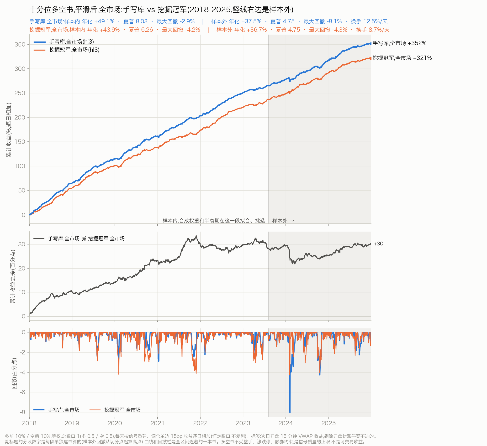
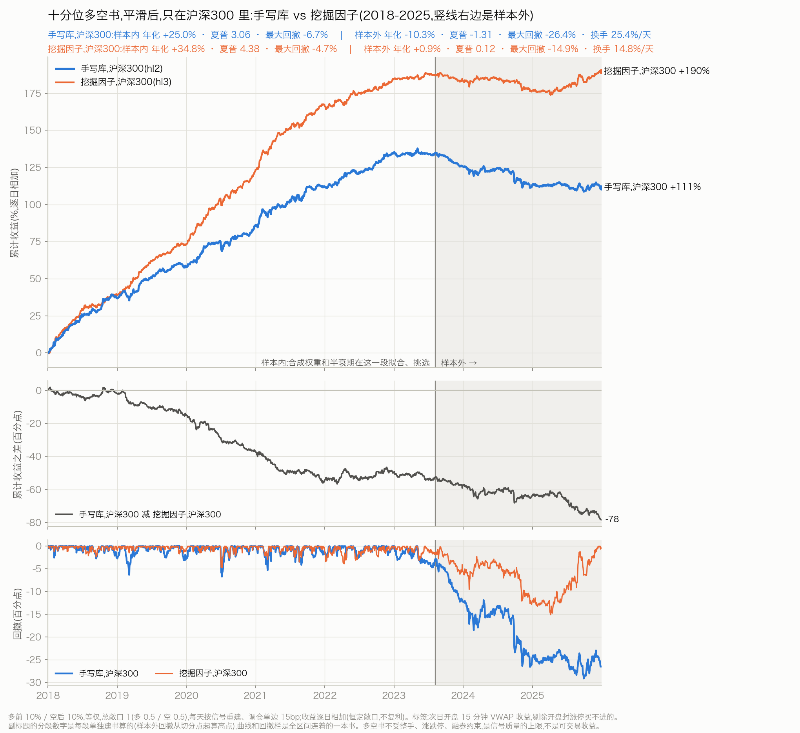
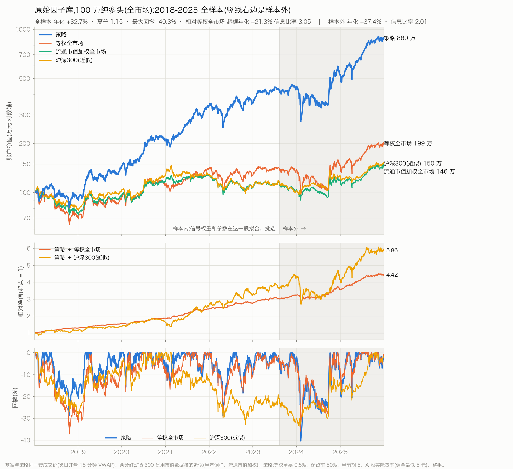
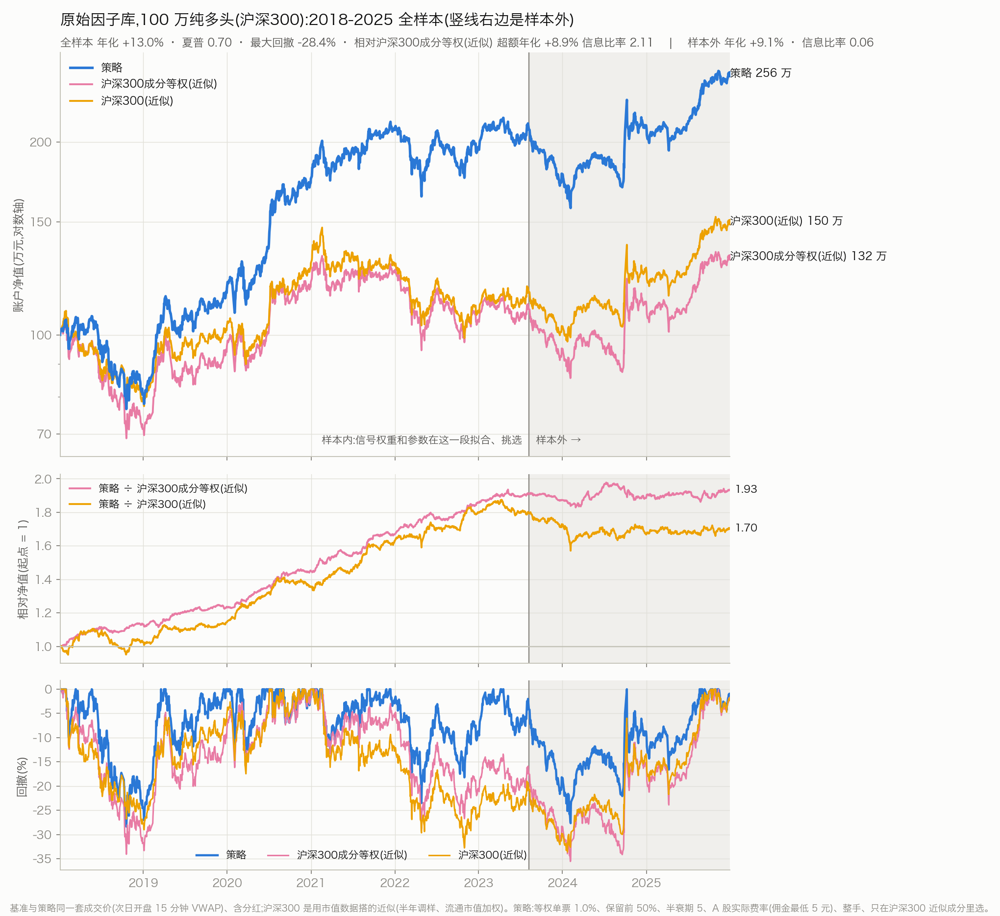
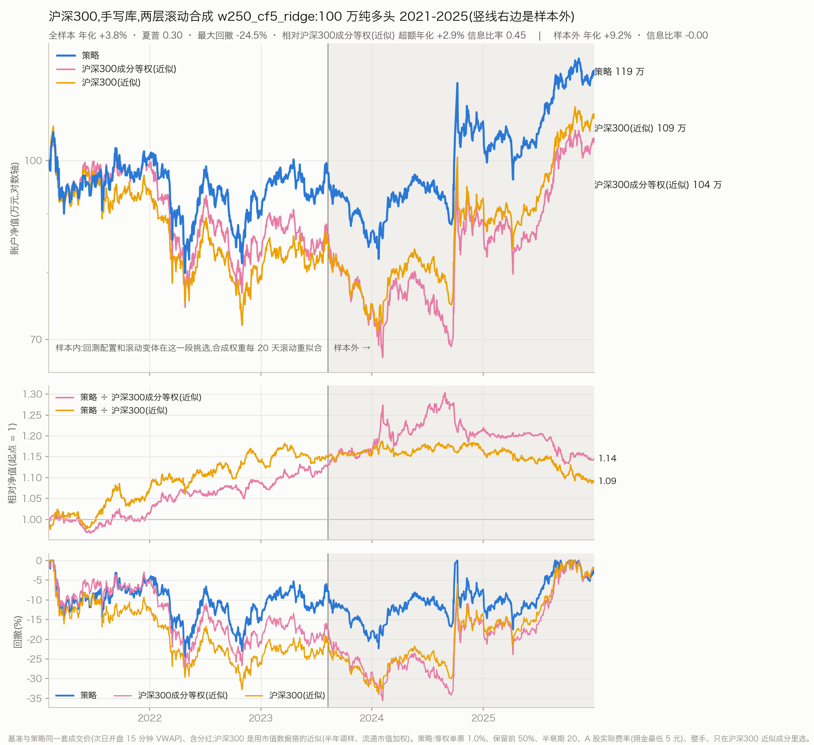
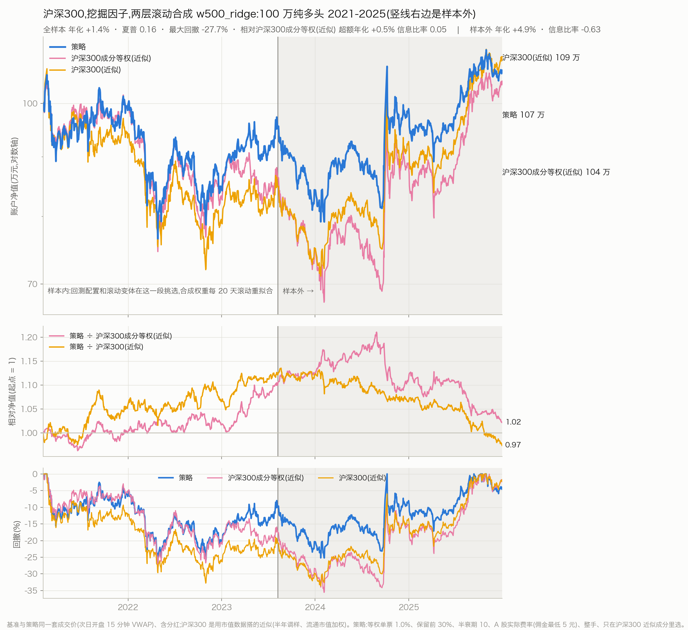
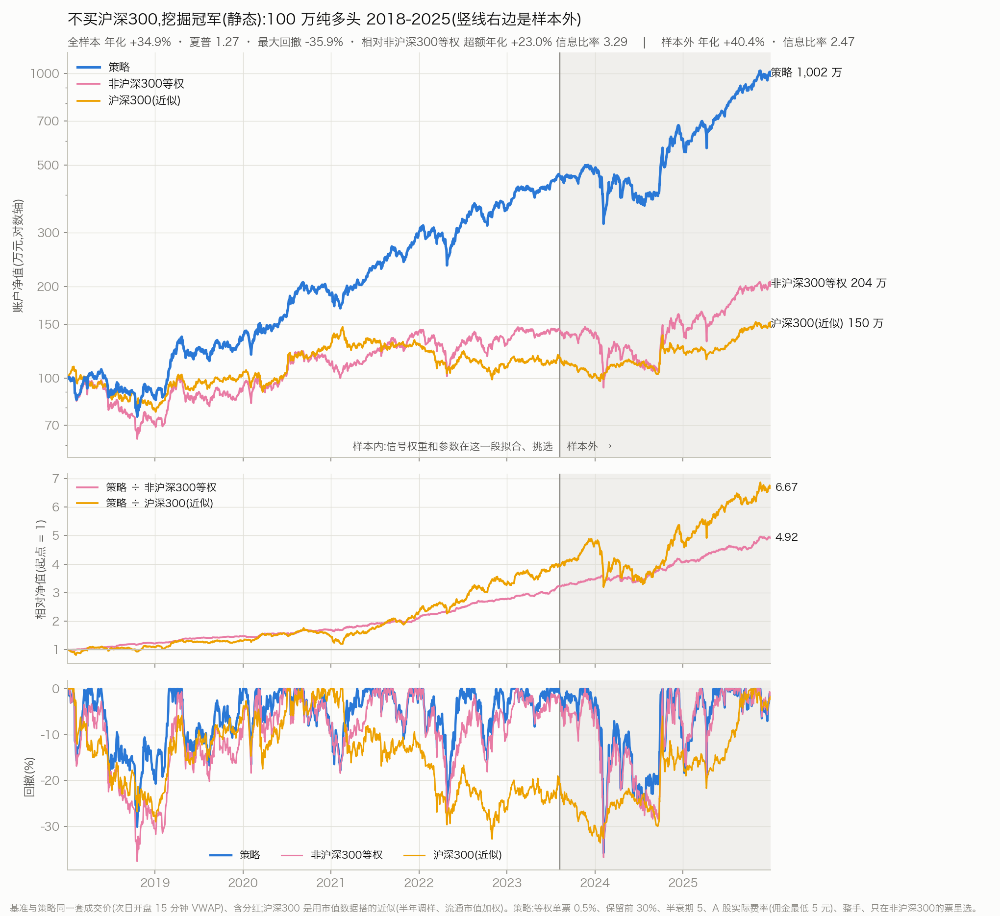
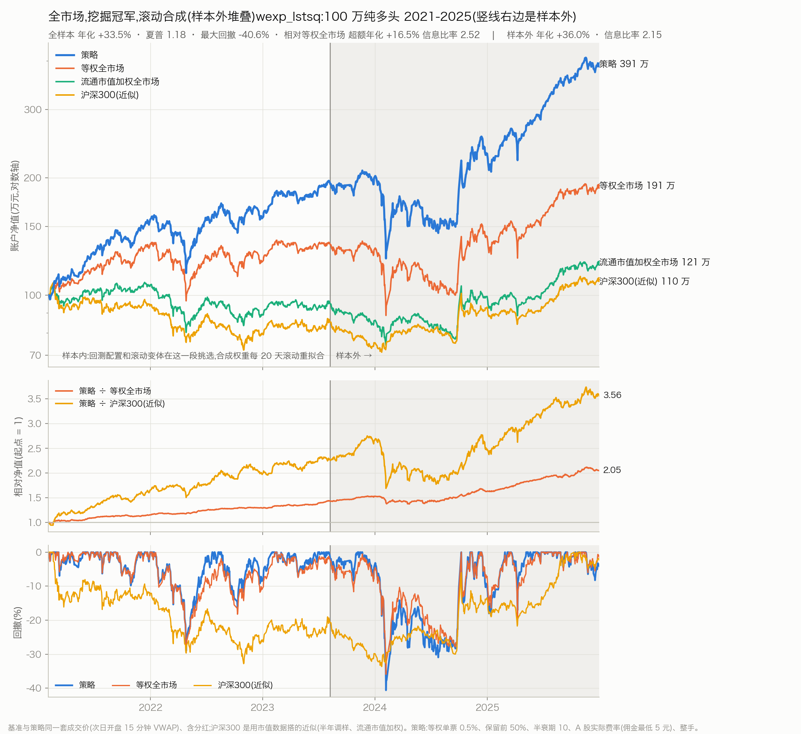
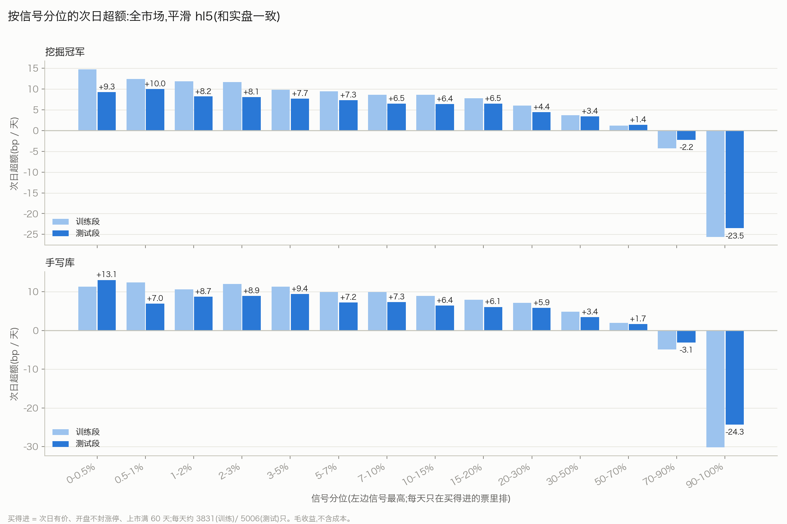

# 可交易回测:从理想权重到 100 万真账户

> 活文档,写法同 `docs/选因子与合成.md`:记录每一步为什么这么做、哪个数字把判断掰回来。
> 新证据往后追加,不删旧判断。
> 最后更新:2026-10-02(§10 剔除买不进的标签、§11 多空搬到纯多头、§12 全样本 100 万净值、§13 只在沪深300 里)。
> 代码:`scripts/tradable_backtest.py`(`prepare` / `run` / `sweep`)、`scripts/build_champion.py`、
> `scripts/ls_anatomy.py`、`scripts/signal_curve.py`、`scripts/long_side_fit.py`,
> 标签开关 `Label(buyable=True)` 在 `src/alphacube/label.py` + `src/alphacube/tradability.py`;测试同名。
>
> **§2~§9 用的是原冠军(原标签拟合);§10 起换成剔除封板标签重新拟合的新冠军,现在以 §10 为准。**

**口径**:冠军信号 `_bench/champion_signal.npy`(两层合成,族内 ridge x 族间 lstsq)。测试段起点
2023-08-08 放入 **100 万元**,复利滚到 2025-12-31(581 个交易日)。基准 = 等权全市场(不计成本)。
**参数一律在训练段选**(训练段按"资金恒定 100 万"跑,免得前几年的盈亏把资金规模带偏),测试段只报数。
费用两套:

- 项目口径:单边 15bp;
- A 股实际费率:佣金万 2.5(**每笔最低 5 元**)+ 卖出印花税(2023-08-28 起万 5,之前千 1)
  + 过户费十万分之一 + 滑点 5bp。100 万分到几百只、每笔几千元时,最低佣金让它**比 15bp 还贵**。

---

## 1. 真账户回测器做了什么

- **成交时点**:决策日 t 收盘后出信号,t+1 开盘 15 分钟 VWAP 成交,持有到 t+2 同一时点 —— 和标签
  `open_vwap15` 同口径。
- **记账**:按"后复权单位"记,除权除息市值不跳;股数用**不复权**价(ΣAmt/ΣVolume)判断。
- **交易单位**:主板/创业板 100 股一手;科创板单笔 >= 200 股、之后按 1 股递增;清仓允许卖零股;
  已有持仓的增减量不够一笔就不动(现金分红在后复权记账下会让股数带小数尾巴,不能为了尾巴卖掉一整手)。
- **买不进、卖不出**:开盘 15 分钟封涨停的买不进,封跌停的卖不出。"封死"指窗口最低价都在涨停价附近;
  一字板且离昨收超过 4.5% 也算,用来兜 ST。停牌不能交易,按最后价格估值;单笔不超过开盘 15 分钟成交量的 10%。
- **上市不足 60 天不买**:上市日按生命周期状态算,不用"第一个有价格的日子"(那会把 2018 年初恰好停牌的
  老股当成次新股)。先剔掉再排名,不占候选池名额。
- **科创板开盘价补齐**:见 §3。

## 2. 第一轮:从 +1.92 到 +1.66

| 步骤(测试段) | 超额夏普 | 备注 |
|---|---|---|
| 原网格:前 20%·exp1·hl5,权重口径,单边 15bp | +1.92 | 复现一字不差 |
| 换成真账户记账(净值复利、持仓随价漂移) | +1.93 | |
| 补齐科创板缺失的开盘价(基准同步补齐) | +1.98 | 停牌挂账 4.8% -> 0.1% |
| 涨跌停买卖不了 + 成交量上限 10% | +1.79 | |
| 把前 20% 的权重直接取整成整手 | **−0.03** | 1000 只每只 1000 元,一半现金买不进 |
| 用户目标(greedy),cap/hl 训练段选(0.2%·hl10) | +1.81 | |
| 再剔除上市不足 60 天(仍是 0.2%·hl10) | +1.81 | |
| 换成 A 股实际费率,cap/hl 重选(0.5%·hl10) | **+1.66** | 一年费用 4.6% |

## 3. 三个数据问题(影响不止回测,都还没修)

> 2026-10-01 下午:第 2 条(标签含买不进的收益)已修,见 §10;第 1、3 条还在。

1. **科创板分钟 Vwap 大面积缺失**。科创板在正常交易的股票日里,标签价算不出来的比例:训练段 17.1%、
   测试段 14.4%;主板和创业板只有 0.0%~0.1%。原因是开盘 15 分钟每分钟都有成交,但 Vwap 字段常常
   只剩两三分钟有值,而标签要求至少 5 分钟。复权因子一天之内每分钟都一样(实测 Vwap/(Amt/Vol) 恒为
   6.8897),所以回测里用 不复权 VWAP15 x 当天复权因子 补齐(`fill_prices`)。**标签本身仍缺着**,
   约占全部标签的 1.8%,挖因子和训练都受影响。
2. **标签里有买不进的收益**,合成权重在训练段学会了追它们。训练段(hl5)信号前 22 只:

   | | 次日封涨停 | 上市 < 60 天 | 日均超额:全部 | 去掉封板 | 再去掉次新 |
   |---|---|---|---|---|---|
   | 训练 前 22 | 12.1% | 52.7% | +62.9bp | **−33.6bp** | −0.0bp |
   | 训练 前 200 | 1.5% | 8.2% | +15.7bp | +5.3bp | +9.4bp |
   | 测试 前 22 | 2.5% | 2.9% | +14.7bp | −0.4bp | +0.3bp |
   | 测试 前 200 | 0.4% | 0.6% | +10.5bp | +8.3bp | +8.5bp |

   2018~2021 年新股上市连续一字板,标签照样记 +10%;开板能买进时正好接在山顶。2023 年主板注册制
   以后这种票基本消失,所以测试段只受轻伤。这也是训练段"越集中越差"(cap 5% 训练段 −3.3)的主因。
3. **立方体里没有 ST 标记**。只能靠"开盘一字板"间接认出 ST 封死的那些天,ST 股本身没法整体剔除。

## 4. 目标函数、单票上限、整手

- 用户目标 `max Σ w_i·exp(MinMax(signal_i))`,s.t. 整手、`w_i <= cap`。exp(MinMax) 是信号的单调变换、
  而且恒 >= 1,所以**最优解就是"按信号降序,每只买到 cap,钱用完为止"**。exp/MinMax 只决定次序,
  持几只完全由 cap 决定(约 1/cap 只)。也因为每只得分都 >= 1,目标函数会把零钱塞进任何一只票,
  所以只在信号前 20% 里分配。
- **单票上限**:训练段在 0.2%~0.5% 最好(200~600 只)。越集中越差,和"弱而广"的信号一致。
  无上限 = 全仓一只票,超额回撤(累加口径)−74% 到 −235%。**cap 能堵住 §5.5 里 exp5/softmax 的退化**。
- **整手**:用 greedy 分配时,100 万下整手基本不伤收益。cap 0.2% 时整手 +1.81、可以买零股 +1.72;
  整手略高是因为被迫偏向低价股(cap 0.5% 时持仓均价 9.7 元 vs 16.7 元)并多持了二十几只,算测试段运气,
  不是整手的功劳。但 cap 0.1%(每只 1000 元)时一半现金买不进,结果为 0。

## 5. 信号强度和次日收益是驼峰形,不是越强越好

> §10 更新:这个驼峰基本是标签污染造成的。用剔除封板的标签重新拟合以后,训练段从上到下单调,
> 前 0.2% 从 −16.9bp 变成 +14.9bp。下面"头部领先离谱多半是异常值"的判断,针对的是原冠军。

只看买得进的票(去掉次日封板、上市 < 60 天),hl10,日均超额(bp,括号里是 t 值):

| 信号分位 | 0~0.2% | 0.2~0.5% | 0.5~1% | 1~2% | 2~5% | 5~10% | 10~20% | 20~50% | 50~100% |
|---|---|---|---|---|---|---|---|---|---|
| 训练 | **−16.9 (−5.1)** | +3.1 | +7.5 | **+12.1** | +9.6 | +8.9 | +7.0 | +3.8 | −5.4 |
| 测试 | +3.2 (0.7) | +9.9 | +6.6 | +8.8 | **+9.4** | +6.8 | +6.2 | +2.9 | −4.5 |

按截面 z 值分组也一样:z > 4 的训练段 −35bp/天。用户的设想是"融合因子值差距大时,前几名的权重可以
高一些"。为了检验,按"第 1 名比第 50 名高出多少个 z"把日子三等分:

| | 领先小 | 领先中 | 领先大 |
|---|---|---|---|
| 训练:前 10 名 / 第 11~200 名 | +3.3 / +10.3 | +5.4 / +6.8 | **−34.1 / +11.6**(z 差 13.1) |
| 测试:前 10 名 / 第 11~200 名 | +3.3 / +8.0 | +0.7 / +14.0 | +5.5 / +4.6(z 差 7.6) |

**头部领先得离谱的时候,多半是异常值,不是更强的信号。** 六个格子里前 10 名没有一次明显好过第 11~200 名。

## 6. 省手续费:保留区 >> 不调区间 >> 单票下限

### 6.1 不调区间:"已有持仓离目标不到 25% 就不调"(2026-10-01 发现,训练段复核成立)

不设保留区、cap 0.5%、A 股实际费率:

| | 不调 0 | 10% | 25% | 50% | 75% | 100% |
|---|---|---|---|---|---|---|
| hl10 训练 / 测试 | +2.19 / +1.66 | +2.36 / +1.77 | **+2.52 / +1.84** | +2.57 / +1.87 | +2.58 / +1.85 | +2.59 / +1.85 |
| hl10 测试费用/年 | 4.6% | 3.6% | **3.2%** | 3.1% | 3.1% | 3.1% |
| hl5 训练 / 测试 | +1.96 / +1.48 | +2.13 / +1.57 | +2.28 / +1.64 | +2.32 / +1.66 | +2.34 / +1.67 | +2.32 / +1.64 |

训练段和测试段方向一致,25% 之后基本饱和。**机制**:换手几乎不变(3.6% -> 3.6%),费用却降了三成。
它砍掉的是"追着价格漂移补一两手"的小单,这些单子每笔都付 5 元最低佣金。所以在单边 15bp 口径下它几乎没用
(hl5 训练 +2.53 -> +2.59)。**不调区间对付的是"每笔固定成本",不是换手。**

### 6.2 老持仓保留区:排名还在前 x% 的持仓原样不动,先占预算,剩下的钱再按排名补新票

cap 0.5%、hl5、A 股实际费率(训练 / 测试 超额夏普,测试费用/年):

| | 不调 0 | 25% | 50% | 75% | 100% |
|---|---|---|---|---|---|
| 不保留 | +1.96 / +1.48 6.2% | +2.28 / +1.64 4.8% | +2.32 / +1.66 4.7% | +2.34 / +1.67 4.7% | +2.32 / +1.64 4.7% |
| 保留前 20% | +2.85 / +1.84 1.7% | +2.86 / +1.80 | +2.86 / +1.90 | +2.79 / +1.80 | +2.89 / +1.75 |
| 保留前 30% | +2.84 / +1.85 1.4% | +2.99 / +1.92 | +3.02 / +1.93 | +2.94 / +1.90 | +2.90 / +1.75 |
| 保留前 40% | +2.97 / +1.77 1.2% | +3.05 / +1.69 | +2.98 / +1.94 | +3.07 / +1.79 | +3.03 / +1.81 |
| 保留前 50% | +2.86 / +1.92 1.1% | +2.95 / +1.83 | +2.90 / +1.93 | +2.98 / +2.02 | +3.02 / +2.17 |

- **这是最大的杠杆**:日换手 5.5% -> 1.0%~1.6%,费用 6.2% -> 1.0%~1.7%/年,训练段 +0.9。
  单边 15bp 口径下同样成立(训练 +2.53 -> +2.96~+3.17)。
- 换手主要花在"排名在边界上进进出出"上;不调区间只管已有持仓的大小,管不到进出。
- **有了保留区,不调区间就基本没作用了**(各列差别在噪音范围内)。
- 是一块宽平台:保留前 20%~50%、不调 0~100%,训练 +2.79~+3.07,测试 +1.69~+2.17(中位约 +1.85)。
  在平台上挑最高点没有意义。

### 6.3 单票下限:更少、更大的仓位反而变差

用户的提议:单票有上限也该有下限(比如 1%),免得买几百只、每天被手续费吃掉。等权时下限 = 上限 = 每只仓位:

| 每只仓位 | 0.3% | 0.5% | 1% | 2% |
|---|---|---|---|---|
| 训练 / 测试 | +2.92 / +1.97 | **+3.07** / +1.79 | +2.57 / +1.79 | +1.92 / +1.56 |
| 测试费用/年 | 1.7% | 1.1% | 0.8% | 0.7% |

(带保留区前 40%、不调 75%、hl5、A 股实际费率。)**费用问题不在只数,在换手。** 有了保留区,0.5% 和
1% 的费用只差 0.35%/年,而换来的分散度损失更大,因为信号是"弱而广"的。

## 7. 仓位怎么分:按强度分仓不行;剔除极端头部,训练段说行,测试段不确定

> §10 更新:新冠军上"剔除极端头部"在训练段也不再有帮助;按强度分仓仍然不行。

**按强度分仓**:目标仓位随截面 z 值在 [下限, 上限] 之间线性变化,z <= 1 给下限,z >= z_hi 给上限。
试了 7 组上下限 x 3 个 z_hi = 21 种,训练段**全部输给等权 0.5%**,每组的最好一格:

| [下限, 上限] | 0.25%, 1% | 0.25%, 2% | 0.5%, 1% | 0.5%, 2% | 0.5%, 3% | 1%, 2% | 1%, 3% |
|---|---|---|---|---|---|---|---|
| 训练 / 测试 | +2.76 / +1.74 | +2.52 / +1.68 | +2.72 / +1.87 | +2.36 / +1.72 | +2.19 / +1.61 | +2.04 / +1.63 | +1.65 / +1.68 |

和 §5 一致:越往极端头部加仓越差。

**剔除信号最前 x% 不买**(等权):训练段一致变好(cap 0.5%:+3.07 -> +3.20~+3.34),
测试段好坏参半(+1.79 -> +1.79~+1.98;cap 1% 时 +1.63~+1.99)。训练段的好处主要来自训练期头部那批
异常票,测试段这批票弱了但不差(§5:+3.2bp)。可选,但不是稳的结论。

## 8. 现在最真实的版本(A 股实际费率,100 万)

> §10 更新:换成新冠军后是 **+2.28**(平台 +2.1~+2.5),以 §10 为准。下面是原冠军的数。

两轮都在训练段选。第 1 轮选省费设置:不调 75%、保留前 40%、hl5。第 2 轮选仓位分法:等权 1%、
剔除信号最前 1%(训练 +3.51)。测试段结果:

| | 超额夏普 | 超额年化 | 超额回撤 | 绝对夏普 | 期末资金 | 费用/年 | 持股 | 分年超额 2023 / 2024 / 2025 |
|---|---|---|---|---|---|---|---|---|
| 上一版(等权 0.5%·hl10) | +1.66 | +18.3% | −14.6% | +1.14 | 209.9 万 | 4.63% | 217 | +11.5% / +9.9% / +20.7% |
| **训练段选出** | **+1.77** | +17.9% | −15.3% | +1.13 | 208.4 万 | **0.73%** | 184 | +13.7% / +4.7% / +22.8% |
| 平台中心(等权 0.5%、不调 50%、保留前 30%) | +1.93 | +18.8% | −13.6% | +1.18 | 213.6 万 | 1.30% | 299 | +13.5% / +6.7% / +23.2% |

正式数字是 **+1.77**。训练段第 2 轮里 cap 1% 和 0.5%(都剔除前 1%)只差 0.001,等于抛硬币;平台上
的测试段在 +1.7~+2.2 之间。**稳的结论是"保留区把费用从 4.6% 压到 1% 左右",不是哪一格的夏普。**

## 9. 还没做的

- **修标签后重新拟合冠军信号**:补齐科创板开盘价,剔除"次日开盘封板买不进"的收益。信号头部现在有一部分
  在追买不进的票,修掉以后可交易的部分可能会变强。这是下一步最值钱的一件事。
- 极端头部(§5)里是什么票:复牌不久的票?可以考虑"复牌不足 N 天不买"。
- ST 标记(要找数据源)。
- 资金规模扫描(1000 万 / 1 亿 / 10 亿),交接文档 §9.4 的二维表。
- 滚动验证:仍然只有一次切分。

## 10. 剔除"次日开盘封涨停、买不进"的收益之后(2026-10-01 下午)

**改了什么**:`Label("open_vwap15", 1, buyable=True)` 把"决策日 t 的股票在 t+1 开盘 15 分钟封死涨停"
的那一格标签置为 NaN。只剔买入侧:封跌停买得进,不剔。封板判定和真实回测共用
`alphacube.tradability`。科创板缺失的开盘价**没动**(用户那边暂时修不了)。

剔掉的只是一小撮格子:训练段 11036 格,占有标签的 0.21%;测试段 0.16%。但它们正好压在信号的最顶端。

**重跑了整条冠军流水线**,配置不变,只换标签:
1. `score_all_factors.py --buyable` 重新打分:4206 个因子,健康 4193 个。掉出去 3 个退化因子,都是
   sigmoid 套 sigmoid、取分位数这类截面大量同值的写法;剔掉封板行以后,算得出 IC 的天数不到一半。
   单因子训练段 rank IC 新旧相关 0.997,中位 |rank IC| 0.0181 -> 0.0177。
2. 按健康因子清单重建训练段指纹,再聚类:1595 族,241 族过门槛,取前 100 族。
3. `build_champion.py --buyable`:族内 ridge、族间 lstsq,写出 `_bench/champion_signal_buyable.npy`,
   100 个族因子另存 `.families.npy`(4 GB)。

**项目口径对比**(测试段;纯多头 = 前 20%·exp1,半衰期训练段选):

| 信号 | 评估标签 | 多空平滑后 | rank IC | ICIR | 纯多头超额夏普 | 超额回撤 |
|---|---|---|---|---|---|---|
| 原冠军 | 原标签 | +3.98 | 0.0583 | 0.443 | +1.92 | −10.6% |
| 原冠军 | 剔除封板 | +4.33 | 0.0595 | 0.450 | +1.88 | −10.5% |
| 新冠军 | 原标签 | +3.99 | 0.0579 | 0.506 | +1.97 | −5.3% |
| **新冠军** | **剔除封板** | +4.75 | **0.0601** | **0.522** | **+2.15** | **−5.3%** |

纯多头要看"剔除封板"那一行。多空那一列在这个口径下偏乐观:空头腿里次日封涨停的票也被剔了,
而做空方在涨停价是卖得出去的。多空的公平口径见 §11 的"开盘能成交"。

**驼峰消失了**。按信号分位看日均超额(bp),hl10,只看买得进的票,`signal_curve.py`:

| 分位 | 0~0.2% | 0.2~0.5% | 0.5~1% | 1~2% | 2~5% | 5~10% | 10~20% |
|---|---|---|---|---|---|---|---|
| 原冠军 训练 | **−16.9** | +3.1 | +7.5 | +12.1 | +9.6 | +8.9 | +7.0 |
| 新冠军 训练 | **+14.9** (t 5.9) | +15.6 | +11.9 | +11.7 | +10.4 | +8.6 | +7.5 |
| 原冠军 测试 | +3.2 | +9.9 | +6.6 | +8.8 | +9.4 | +6.8 | +6.2 |
| 新冠军 测试 | +9.1 | +9.9 | +12.4 | +7.4 | +7.4 | +7.1 | +5.1 |

§5 的"极端头部是异常值",基本就是标签污染造成的:标签记下买不进的涨停收益,合成权重就学去追那批票,
真能买进的时候正好接在山顶。修掉以后,训练段从上到下单调。所以 §7 的"剔除极端头部"在新信号上
也不再有帮助(训练 +4.04 vs 不剔 +4.07)。

**真实回测**(100 万、A 股实际费率、上市不足 60 天不买,`sweep` 两轮都在训练段选):

| | 训练 | 测试超额夏普 | 超额年化 | 超额回撤 | 绝对夏普 | 期末资金 | 费用/年 |
|---|---|---|---|---|---|---|---|
| 原冠军,训练段选出(§8) | +3.51 | +1.77 | +17.9% | −15.3% | +1.13 | 208.4 万 | 0.73% |
| **新冠军,训练段选出**(等权 0.5%、保留前 50%、不调 100%、hl5) | **+4.07** | **+2.28** | +17.0% | **−7.2%** | +1.16 | 206.5 万 | 1.22% |
| 新冠军,保留区平台上的所有格(保留前 20~50%) | +3.79~+4.07 | +2.12~+2.48 | | 约 −7% | | | 1.2%~2.0% |
| 新冠军,不设保留区(上一版做法) | +2.82 | +1.39 | | | | | 6.1% |

第 2 轮仓位分法里,等权 0.5% 仍然最好;按强度分仓在训练段仍然全部输给它。

## 11. 多空夏普 4 能不能低成本搬到纯多头:构思与实测(2026-10-01)

### 11.1 先拆开看夏普 4 从哪来

`ls_anatomy.py`:十分位多空书拆成两条相对等权全市场的腿,每条腿再按"能不能交易"一层层收紧。
空头腿另给一列"相对本池":空头只在一部分票里做时,减去那部分票自己的等权收益,剥掉风格。
新冠军,hl3,测试段,单边 15bp:

| 口径 | 多头腿 年化 / 夏普 | 多头腿相对本池 | 空头腿 年化 / 夏普 | 空头腿相对本池 | 多空 年化 / 夏普 |
|---|---|---|---|---|---|
| 原标签 | +11.4% / 1.35 | +11.3% / 1.34 | +50.8% / 4.73 | +50.9% / 4.73 | +31.1% / 3.99 |
| 开盘能成交(多头剔封涨停、空头剔封跌停) | +10.9% / 1.30 | +12.5% / 1.48 | +46.1% / 4.30 | +46.8% / 4.37 | +28.5% / 3.65 |
| 空头只做流动性前 50% | 同上 | 同上 | +68.0% / 4.42 | **+57.3% / 4.02** | +39.4% / 4.13 |
| 多头只做流动性前 50% | −2.5% / −0.41 | **+10.5% / 1.51** | +46.1% / 4.30 | | +21.8% / 3.32 |
| 多头只做流动性后 50% | +13.7% / 1.26 | **+3.4% / 0.49** | +46.1% / 4.30 | | +29.9% / 3.47 |

(流动性 = 近 20 日日均成交额排名,融券标的的粗代理。分年,开盘能成交口径:多头腿 2023 下半年 +4.5%、
2024 +12.8%、2025 +7.9%;空头腿 +15.7% / +52.1% / +38.4%。原冠军的结构几乎一样。)

- **夏普 4 的大头在空头腿**(夏普约 4.3),去掉封跌停卖不出的也只少不到 5 个点/年,是真的。
  在流动性好的票里更强,相对本池 +57%/年,不是小票借不到券的假象。
- **多头的选股能力集中在流动性好的那一半**(相对本池 +10.5%,夏普 1.5)。小票那一半的"超额"主要是
  小票本身跑赢了大盘(相对本池只有 +3.4%)。
- 纯多头拿不到负权重,空头信息只能靠"不持有"来用。后 10% 在等权全市场里占 10% 权重,全部不持有,
  最多拿到约 0.1 x 46% ≈ 4.6%/年 —— 现在的前排组合只持头部,这一块**已经拿到了**。
  剩下的四十多个点,没有做空就拿不到。

### 11.2 几条路,按"能不能做、要付什么"排

| 路线 | 做法 | 证据(测试段) | 门槛 / 成本 | 结论 |
|---|---|---|---|---|
| A 前排组合(现状) | 新冠军 + 保留区,等权 0.5% | 真实回测超额夏普 +2.28(平台 2.1~2.5),超额年化约 17~19%,回撤约 −7% | 100 万可做,一年费用约 1.2% | 小资金下这就是上限附近 |
| B 宽基剔除输家 | 等权持有全市场,只剔除信号后 10%~30% | 理想口径(不计整手):剔除后 10%(hl3)超额 +4.5%/年、**夏普 +3.65**、回撤 −1.4%;剔除后 30%:+7.6%、+2.96 | 要持有 3400~4400 只:100 万做不到。5000 万~2 亿按"开盘 15 分钟、10% 成交量"成交,小票买不满,现金闲置 6%~18%,超额夏普掉到 +0.1~+2.0 | **空头腿的夏普能搬过来,收益搬不过来**;要大资金加全天分批成交才验证得了 |
| C A、B 混合 | a·B + (1−a)·A | a = 0.5:超额 +7.9%,夏普 2.19;a = 0.75:+5.5%,2.53(理想口径;两者日超额相关 +0.38) | 同 B | 一条收益和夏普的取舍线 |
| D 股指期货对冲 | A 或 B,再空 IM/IC | **没测**:立方体里没有期货价格、没有指数成分股 | 基差(贴水)、保证金占资金;IM 一手名义约 120 万,100 万账户对冲不精确 | 能把"超额"变成"绝对收益",但不是多出来的 alpha;B 要先按对冲指数的成分股重做 |
| E 真做空 | 融券或收益互换,做空流动性好的输家 | 空头腿在流动性前 50% 相对本池 +57%/年,夏普 4.0 | 2024 年起转融券暂停、量化融券受限;借券费约 8%~10%/年 | **唯一能拿到空头腿大头的路**,看能不能拿到券 |

试过、否掉的:

- **只为多头重新拟合族间权重**(`long_side_fit.py`):只用信号前 30%/50% 的样本拟合。直接拿去给全市场打分时,
  连训练段都是负的(−1.4 / −3.2),因为模型会把它从没见过的尾部票推到前排。改成两段式(冠军先筛头部,
  新模型只在头部里排)以后,毛收益多 2~3 个点,但换手翻倍、费用翻倍,训练段 +3.56~+3.60 仍不如全截面 +4.01;
  秩标签更差(训练 +1.54)。**全截面 lstsq 对纯多头已经够好**。
- **用空头侧的"过热度"择时**:过热度 = 信号后 10% 占全市场近 20 日成交额的比例,原假设是过热就降仓。
  实测方向相反,过热度最高的 1/5 日子之后,等权全市场 5 天平均 +182bp(测试段)。资金扎堆在"会跌"的票上
  的时候,往往是做多情绪最旺的阶段:个股会跌回来,大盘还在涨。
- **按信号强度在上下限之间分仓**:新信号上也是训练段全部输给等权。

### 11.3 下一步要什么

- 想做市场中性(D):需要 IM/IC 的日线和基差、中证 1000/500 成分股及权重。拿到以后可以按对冲指数的成分股
  重做 B("成分股里剔除输家 + 头部加仓"),直接回测对冲后的绝对收益。
- 想拿空头腿(E):需要融券标的名单和实际可借数量、费率,哪怕只有一部分流动性好的票也够。
- 大资金版的 B:要把成交假设从"开盘 15 分钟"换成全天分批(标签也要配套换),否则现金闲置会把结果压低。

## 12. 全样本:100 万从 2018 年初滚到 2025 年底(2026-10-01)

`scripts/tearsheet.py`:`compute` 在服务器上跑策略、算基准、出指标,`plot` 在本地画图。

- **策略**:§10 训练段选出的配置。新冠军,平滑半衰期 5,等权单票 0.5%,保留前 50%,不调 100%,
  上市不足 60 天不买,A 股实际费率,整手。2018-01-02 放入 100 万,一直复利到 2025-12-31,中间不重置。
- **基准**:三条基准都和策略用同一套成交价和时点(次日开盘 15 分钟 VWAP,后复权,含分红):
  - 等权全市场;
  - 流通市值加权全市场;
  - 沪深300(近似)。立方体里没有指数行情,用 `daily_capital` 的市值数据搭:每年 1 月、7 月第一个交易日调样,
    在过去 250 天日均成交额前 50% 的票里,取日均总市值前 300 只,按流通市值加权。
- **口径警告**:
  - 信号权重和参数都是在 2023-08-08 之前拟合、挑选的,**分界线以前是样本内,数字偏乐观**。
  - 样本外这一段从分界点接着跑,账户已经滚到约 407 万,单只仓位更大、整手摩擦更小,所以比 §10
    "2023-08 用 100 万现金重新起步"的 +2.28 好看一些。
  - 沪深300 近似没做自由流通调整,银行、石油这类大国企权重偏高。和公开的沪深300 价格指数比,年度误差有
    ±5~9 个点:2024 年近似 +23.4%,真实 +14.7%。只能看个大概,要精确得拿真实指数行情。


| 全样本 2018-01-04 ~ 2025-12-31 | 累计 | 年化 | 波动 | 夏普 | 最大回撤 | 卡玛 | 月胜率 |
|---|---|---|---|---|---|---|---|
| **策略** | **+784.6%**(100 万 -> 885 万) | **+32.7%** | 25.6% | **1.23** | −34.5% | 0.95 | 62.5% |
| 等权全市场 | +99.4% | +9.4% | 24.7% | 0.49 | −37.2% | 0.25 | 52% |
| 流通市值加权全市场 | +46.2% | +5.1% | 19.2% | 0.35 | −31.1% | 0.16 | 54% |
| 沪深300(近似) | +50.2% | +5.4% | 18.2% | 0.38 | −33.6% | 0.16 | 53% |

| 策略分段 | 年化 | 夏普 | 索提诺 | 最大回撤 | 对等权:超额年化 / 跟踪误差 / 信息比率 / 超额回撤 | 对沪深300 近似:超额年化 / 信息比率 | 换手/天 | 费用/年 |
|---|---|---|---|---|---|---|---|---|
| 全样本 | +32.7% | 1.23 | 1.80 | −34.5% | +21.4% / 6.0% / **3.28** / −5.9% | +25.9% / 1.25 | 1.41% | 1.22% |
| 样本内 | +29.8% | 1.27 | 1.81 | −30.0% | +21.8% / 5.3% / 3.69 / −4.2% | +26.1% / 1.42 | 1.49% | 1.45% |
| **样本外** | **+40.0%** | 1.22 | 1.83 | −34.5% | +20.4% / 7.3% / **2.66** / −5.9% | +25.4% / 1.04 | 1.21% | 0.67% |

| 年 | 策略 | 等权全市场 | 流通市值加权 | 沪深300(近似) | 超额(对等权,几何) |
|---|---|---|---|---|---|
| 2018 | −15.9% | −29.5% | −25.7% | −21.3% | +19.4% |
| 2019 | +54.0% | +31.4% | +29.7% | +31.3% | +17.2% |
| 2020 | +42.6% | +20.8% | +22.9% | +25.3% | +18.0% |
| 2021 | +57.0% | +26.4% | +8.5% | −0.2% | +24.2% |
| 2022 | +13.1% | −9.9% | −16.0% | −15.5% | +25.6% |
| 2023 | +28.6% | +7.3% | −3.8% | −5.5% | +19.9% |
| 2024 | +26.5% | +8.4% | +15.6% | +23.4% | +16.7% |
| 2025 | +65.7% | +34.7% | +21.9% | +17.9% | +23.0% |

读法:

- **超额很稳,绝对收益扛着全部大盘 beta**。相对等权全市场 beta 1.01,八年每年超额都在 +17%~+26%,
  超额最大回撤只有 −5.9%。可绝对最大回撤 −34.5%(2023-11-21 -> 2024-02-06,2024 年初小微盘踩踏,
  2024-10-08 修复),和等权全市场自己的 −37% 差不多。
- **相对沪深300 是"小票 + 选股"两层收益**:跟踪误差约 20%,信息比率 1.25,远低于对等权的 3.28。
  这个组合天然是小票风格,大票领涨的年份(2024)相对沪深300 就吃亏。
- 日均单边换手 1.4%,一年费用 1.2%;平均持股约 310 只,现金约 0.2%。

### 12.1 为什么绝对夏普只有 1.2(2026-10-01)

**组合扛着 100% 的大盘风险,而这几年 A 股大盘本身的夏普只有 0.5 左右。** 夏普 = 收益 / 波动,拆开:

| | 年化收益 | 年化波动 |
|---|---|---|
| 大盘部分(等权全市场,beta ≈ 1) | 约 +9% | **约 25%** |
| 选股超额 | **约 +21%** | 约 6% |
| 合起来 | 约 +33% | 25.6% |

方差里约 95% 来自大盘。选股超额自己的夏普是 21 / 6 ≈ 3.3(信息比率 3.28),和多空的 4 同一量级;
叠上大盘之后,分母几乎全是大盘那 25%:(9 + 21) / 25.6 ≈ 1.2。多空能到 4,是因为空头腿把大盘对冲掉了。

**要抬夏普只能对冲大盘,关键是拿什么对冲**。按样本内回归出的 beta 对冲,下面这些指数近似都用 `daily_capital`
的市值数据搭,半年调样、流通市值加权:

| 对冲工具 | 和策略的相关 | 对冲后夏普(全样本) | 对冲后夏普(样本外) |
|---|---|---|---|
| 不对冲 | — | 1.23 | 1.22 |
| 等权全市场(做不空,理想上限) | 0.97 | 3.30 | 2.66 |
| 沪深300 近似(前 300) | 0.64 | 1.31 | 1.11 |
| 中证500 近似(301~800) | 0.83 | 1.87 | 1.39 |
| 中证1000 近似(801~1800) | 0.90 | 2.29 | 1.75 |
| 中证2000 近似(1801~3800) | 0.97 | 3.49 | 2.98 |

- 组合本质上是小票组合:拿大票指数对冲几乎没用,越往小票去越贴。
- 中证2000 最贴,但没有期货,只有 ETF,要融券卖 ETF。
- 能用期货的最好选择是 IM(中证1000),而期货长期贴水:样本外按 IM 对冲,贴水 0 / 5% / 10% / 15% 一年时,
  夏普 1.75 / 1.46 / 1.16 / 0.87。
- 100 万账户基本对冲不了:IM 一手名义约 120 万,比账户还大,还要占保证金。
- **对冲后的回撤**(中证1000 近似,对冲比例 = 样本内 beta 0.92):最大回撤从 −34.5% 降到约 −22%
  (2024-01-12 -> 2024-02-08),最差月 −8.4%。没降得更多,是因为 2024 年初小微盘踩踏时,这个偏小票的组合
  跌得比中证1000 更狠(那两个月不对冲 −15.3%,中证1000 近似 −8.6%)。对冲去掉的是中盘那部分,
  小票相对中盘的落差还在。贴水 0 / 5% / 10% 时,对冲后全样本年化 +27.7% / +22.0% / +16.6%,
  夏普 2.29 / 1.87 / 1.45。这还没扣保证金占用:约两成资金要放在期货账户,收益还要打八折左右,夏普不变。

想做市场中性,更好的路是把多头放进可对冲指数的成分股里做增强(比如中证1000 成分股里选),再用 IM 对冲,
让对冲残差小下来。这要真实的期货行情、基差和成分股数据。

## 13. 只在沪深300 里:因子打分、合成和回测都限定在大票(2026-10-02)

**股票池**:立方体里没有指数成分股,用 `scripts/universe.py` 搭沪深300 近似名单。规则见 §12:每年 1、7 月调样,
在过去 250 天日均成交额前 50% 里取日均总市值前 300 只。8 年里共 581 只进过名单,调样 15 次,每次换 15~36 只。
名单固定为 `_bench/universe/hs300_proxy_v1.npy`,旁边的 `.json` 记日期和股票顺序。

**两个版本**:

- A 版:全市场训练的新冠军,只在沪深300 里回测;
- B 版:打分、选族、截面标准化、族内和族间拟合、平滑半衰期都只用当天的成分股,再在沪深300 里回测。
  有一处近似:因子面板本身是在全市场算的。冠军用到的 884 个成员因子里有 153 个带 cs_ / nt_cs_ 截面运算,
  这些因子的值是相对全市场排的。

回测参数都在训练段重选:单票 1~5%,保留区,不调区间,半衰期;候选池放开到池内全部。
基准是池内等权和沪深300 近似。

| | 训练段超额夏普(对成分等权) | **样本外超额夏普** | 样本外超额年化 | 样本外 对沪深300 近似 | 一年费用 |
|---|---|---|---|---|---|
| A 版(单票 2%,保留前 30%,hl5) | +1.98 | **+0.44** | +2.5% | 超额 −2.4% | 2.0% |
| B 版(单票 1%,保留前 30%,不调 50%,hl5) | +3.93 | **+0.29** | +1.1% | 超额 −1.7% | 3.3% |

> 2026-10-02 核对:现存的 `_bench/tradable/sweep_hs300_B.json` 里,B 版选中那格的测试段费用是 4.1%/年(上表写 3.3%);
> 72 格测试段范围 A −0.80~+1.85、B −0.52~+1.37,和下文"A −0.68~+0.64、B −0.52~+0.95"不一致。超额夏普 +0.44 / +0.29 对得上。
> 上表费用和下文范围的出处待查,以 JSON 为准。


- **大票里样本外基本没有超额**。72 种构建在测试段的超额夏普,A 版在 −0.68~+0.64 之间,B 版在 −0.52~+0.95 之间。
  按项目口径,测试段 rank IC:A 版 0.015,B 版 0.004(全市场是 0.06)。
- **B 版是典型的过拟合**。B 版拟合的不是新因子,而是同一批因子在 300 只票上的权重,样本太少:
  - 训练段信息比率 4.16、超额 +18.9%/年,样本外 0.32、+1.1%;
  - 分年超额:2018~2022 每年 +10%~+28%,2023 +1.7%,2024 −0.2%,2025 +4.4%;
  - 原始换手 58%,一年费用 3%~4%。
- **单因子在大票里本来就弱**。训练段 |rank IC| 中位 0.006,全市场是 0.018;单因子十分位多空,测试段
  净夏普 > 1 的一个都没有(全市场 22%)。方向倒是一致的:两池训练段 rank IC 的相关 0.86,
  训练段最强 10% 的因子测试段 100% 同号,只是强度不够付成本。

**一个影响全局的发现:因子库是用全样本挖出来的**。`gp_full_market.sh` 和 `rl_full_market.sh` 一直是
`--start 20180102 --end 20251231`,挖掘的奖励(`PanelScorer`)用的是视图里的全部日期,没有训练段切分。
所以 4196 个因子在被挖出来、留下来的时候,就已经"看过"2023-08 以后的测试段。§2~§12 的测试段数字里,
合成权重和参数是只用训练段的,可因子库本身带着选择偏差,偏差有多大现在量不出来。
**要得到真正干净的样本外,得把挖掘的 `--end` 也设在切分点之前。**

**从零开始的沪深300 RL 挖掘(2026-10-02 启动)**,用 `scripts/rl_universe.sh`:

- 名单固定为 `hs300_proxy_v1`;只挖到 2023-08-07,测试段完全留出;
- 不继承全市场的封禁;标签剔除封板;
- `alphacube mine --universe`:引擎只在训练段进过名单的 552 只票上算,截面运算只在大票之间做;
  标签和每个因子面板在当天非成分股的格子上置空,奖励里的 IC、十分位书换手、池子合成都只看成分股;
- 其余配置同 rl1:AlphaGen PPO,2000 回合,奖励 = |rank IC| − 0.14 x 换手,池子 30 个。
- 输出在 `mining_runs/rl_hs300_1/`。

### 13.1 沪深300 的 GP 挖掘,以及审查查出的几个问题(2026-10-02)

用户要求"服务器还有空闲就开 GP,配置和大盘股版 RL 一样"。启动脚本 `scripts/gp_universe.sh`:

- 和 RL 版同一套口径:同一份名单、只挖到 2023-08-07、剔除封板的标签、从零开始不继承封禁;
- GP 自己的参数沿用全市场生产版:种群 64、20 代、每 5 代一块、块内结构封禁 3 个、族去重 0.99;
- 和 RL 同卡同时跑:线程封顶 10,显存封顶 GP 50%、RL 30%;
- 不用指纹磁盘缓存。

启动前用多智能体审查了这条路径(三个视角各自读代码,每条发现再由两个反驳者证伪),查出:

1. **(阻断)GP 绕过了股票池那层**。GPMiner 自己建引擎,`UniverseEngine` 只套在了 RL 用的引擎上。
   修复前的冒烟测试里,池外格子 92% 有因子值;修复后为 0。修法:`run_mining` 构造完 GPMiner 后把它的引擎换成包装过的。
2. **(阻断)RL 奖励在池外格子上被填 0**。`pool.combined()` 把池外填成 0 当成"中性股票",奖励里十分位书的大小和排名都被扭曲。
   **所以 rl_hs300_1(第一版)的奖励有偏差**,结果保留作对照;修正后重跑为 rl_hs300_2。
   修法:`combined()` 在所有成员都缺值的格子上返回 NaN,`_GramCache.pool_ic` 同步,保持逐位一致。
3. **(重要)模型类合成在池外格子上也给预测**。gbdt、lightgbm、xgboost、ridge 等,现在和加权法一样留空。
4. **(重要,因 2 引入的回归)池子奖励可能变成 −inf**。合成信号的覆盖率按 z 分数算,会低于成员的原始覆盖率,
   一旦触发覆盖率门槛,就会把 −inf 喂进 PPO。修法:池子奖励不套这道门槛(`PanelScorer.score(gated=False)`),
   万一仍不是有限值,就退回候选自己的分数。
5. **(重要)股票池挖掘会删掉全市场的指纹缓存**。`ExemplarCache` 一建就清掉同一根目录下别的视图。
   **这次 GP 冒烟测试确实把全市场那份缓存删了**,已用 `warm_exemplar_cache.py` 重建(1851 条、5.3 GB,视图键 3c42e68e…)。
   修法:股票池挖掘的缓存根目录改成 `<root>_universe_<掩码哈希>`。
6. (次要)显存和线程封顶:新增环境变量 `ALPHACUBE_GPU_FRACTION`,`ALPHACUBE_CPU_THREADS` 现在也能限制 GP 打分的线程。

已知的设计近似,没改:表达式内部的截面运算,是在"这段日子里进过名单的全部票"之间做的,
不是逐日只在当天成分股里做。根节点上的截面运算不受影响(在超集里排名再取子集,次序不变)。

### 13.2 沪深300 专门挖掘的干净样本外结果(2026-10-02)

gp_hs300_1(GP,20 代,10 分钟)和 rl_hs300_2(修正版 RL,2000 回合,22 分钟)都只挖到 2023-08-07。
用 `scripts/eval_universe_run.py` 把最终池子的 30 条表达式放到全区间重算:同样只在名单里算,池外置空;
合成权重只在训练段定,equal / ridge / lstsq 三种都报,不在测试段上挑。再用 `sweep --universe` 做 100 万真实回测,
参数在训练段选。**这是项目里第一份从挖掘开始就没碰过测试段的结果。**

| 信号 | 测试段 rank IC | 真实回测:训练段 -> **测试段超额夏普** | 测试段超额年化 | 72 种配置测试段中位 |
|---|---|---|---|---|
| GP ridge | +0.021 | +2.26 -> **+0.76** | +4.7% | +0.31 |
| GP lstsq | +0.021 | +2.23 -> **+0.74** | +4.6% | +0.30 |
| GP equal | +0.047 | +0.27 -> +0.02 | +0.2% | +0.10 |
| RL ridge / lstsq / equal | +0.009 / +0.009 / −0.036 | -> **−0.27 / −0.37 / −0.36** | −1% ~ −3% | −0.19 ~ +0.20 |
| 对照:§13 A 版(全市场因子库,挖掘看过测试段) | 0.015 | +1.98 -> +0.44 | +2.5% | |
| 对照:§13 B 版(同上,沪深300 重拟合) | 0.004 | +3.93 -> +0.29 | +1.1% | |

- **GP 挖出来的 30 条全是低波动**:日内收益方差 `day_cov(Ret, Ret)`、波动的截面离散、单日最大涨幅等,
  都是"波动越低后面越好"。方向在样本外 30 条全部保持,而且更强:训练段 |rank IC| 0.020~0.029,测试段多在 0.03~0.05
  (2023~2025 低波动高股息的大票占优)。等权合成的 rank IC 有 +0.047,可交易收益却很薄:十分位多空 −0.33,
  纯多头 +0.16。排序关系是稳的,钱集中在少数几次风格切换上。
- **GP 的 ridge/lstsq 合成是目前沪深300 里最好的样本外数字(+0.75)**,但量级小:超额 +4.7%/年,一年费用 2%;
  72 种配置的测试段离散很大(−0.7 ~ +1.4)。还不够当成"沪深300 有稳定 alpha"的证据。
- **RL 挖出来的是高换手的日内统计因子**(成交额、成交量的日内分布)。池子在挖掘区间里 ICIR 0.41,可日换手 81%,
  样本外合成扣费后为负。换手惩罚 0.14 约束了单个因子,没约束住池子的合成。
- **第一版 rl_hs300_1 的奖励有偏差**(§13.1),样本外同样为负,结论不变。

> **§14.2 更正(2026-10-02)**:GP 换一个随机种子(gp_hs300_2)重跑,ridge 合成的测试段超额夏普是 **−0.91**。
> 所以上表 gp_hs300_1 的 +0.76 主要是这一次运行的运气,不能当成"沪深300 里 GP 有样本外 alpha"。

## 14. 原始手写因子库:相关性聚类、纯多头回测,以及用它做 GP 起点 / RL 初始化(2026-10-02)

**结论**:

1. 全市场:手写库聚类合成后的 100 万纯多头真实回测,测试段超额夏普 +2.22,和挖掘冠军(+2.28)持平;
   多空书平滑后测试段夏普也同为 +4.75。手写库没有"挖掘时看过测试段"的偏差,所以 §10 的数字大体可信。
2. 沪深300:手写库同样没有可靠超额(纯多头 +0.11 / +0.16,多空扣费为负)。
3. 用手写库做 GP 起点、做 RL 池子初始化,都没有带来可靠的样本外超额;GP 的运行间方差比挖法之间的差别还大
   (同一配置换随机种子:+0.76 -> −0.91)。带种子的 GP 更稳(两次都在 −0.2~+0.2),但不更强。

### 14.1 原始因子库

`src/alphacube/legacy/factor_set_merged.py`,1498 条手写因子(26 个集合),不是 GP / RL 挖的。
`scripts/eval_legacy_factors.py` 在生产视图(1942 天 x 5220 只)上逐个求值,输出和挖掘因子同一个布局,
打分、聚类、合成、回测全部复用 §10 / §13 的脚本(`scripts/legacy_pipeline.sh` 串起来)。

- 解析:迁到 241 根分钟线,按名字内联引用,宽松语法 + 日频折叠;1410 条可以求值。
  88 条不算:33 条用到立方体里没有的字段(申万行业、财务、`inds`),8 条用到库里没有的 `merge_and_forward_fill`,
  11 条括号写错,4 条把分钟算子套在已折叠的日值上,13 条根节点还是分钟级,19 条和前面的结构完全相同。
- 和挖掘同卡时显存封顶,长窗口 ts 运算(alpha_* 一次要 13~17 GB)会 OOM;失败的面板不落盘,
  等显卡空出来再不封顶、一次一条补算。
- 1410 条里 1392 条算出了面板。算不出的 18 条整张卡一次一条也装不下:alpha_31 / alpha_36(全市场 250 天窗口的
  `ts_corr`,一次分配 15~17 GB),以及 16 条用 `ts_pearson`(股票两两相关)/ `in_multireg`(一次 30~56 GB)的。
  打分时按缺失处理。
- 求值时修了一个算子:`in_mask_nearby_ones` 原来逐个元素循环、每次 `.item()` 同步,全市场约 1000 万行要跑几天;
  改成按分钟列扫、所有行一起走,逐位一致(`tests/test_mask_nearby_ones.py`)。它仍被注册表标成 resource_risk,
  搜索词表不变(214 个算子),之前的运行轨迹不受影响。
- 手写因子是作者事先写好的,不存在"挖掘时看过测试段"的问题;但作者写的时候知道哪些想法在 A 股有效,
  这种选择偏差排除不了。

**单因子**:健康 1308 条。训练段 |rank IC| 中位 0.021、90 分位 0.046;挖掘的 4193 条是 0.018 / 0.047。
训练段方向在测试段保持的比例两边都是 96%。手写因子单个看不比挖出来的差。

**聚类 + 两层合成 + 100 万纯多头真实回测**(和 §10 / §13 完全同一套:训练段指纹 |秩相关| 0.7 聚类,
族内 ridge、族间 lstsq,半衰期、回测配置都在训练段选):

| | 族 | 测试段 rank IC | 十分位多空平滑后净夏普 | **真实回测测试段超额夏普** | 测试超额年化 | 费用/年 | 全部格测试中位 |
|---|---|---|---|---|---|---|---|
| **原始库,全市场** | 1308 -> 478 族,取前 100 | 0.050 | +4.75 | **+2.22** | +20.2% | 1.5% | +1.70 |
| 挖掘冠军,全市场(§10) | | 0.060 | +4.75 | +2.28 | +17.0% | 1.2% | |
| 两者逐日秩 z 分数等权 | | | | +2.16 | +19.6% | 1.5% | +1.87 |
| **原始库,沪深300 重拟合(B)** | 1304 -> 460 族,过门槛 75 | 0.016 | −1.31 | **+0.11** | +0.5% | 3.8% | +0.16 |
| 原始库全市场信号,只在沪深300 回测(A) | | | | +0.16 | +1.3% | 1.4% | +0.16 |
| 挖掘因子沪深300 版 A / B(§13) | | 0.015 / 0.004 | | +0.44 / +0.29 | | | |

**十分位多空书**(`scripts/ls_report.py`,口径同 build_champion:多前 10% / 空后 10%,总敞口 1,单边 15bp,
EMA 半衰期在训练段选;年化是日均 x 252、回撤在逐日相加的累计收益上算;两条腿都是毛收益,相对当天全部有信号的票等权,
相加 x 0.5 = 毛多空):

| 全市场 | 段 | 平滑 | 年化 | 夏普 | 回撤 | 换手/天 | 毛夏普 | 多头腿年化 | 空头腿年化 |
|---|---|---|---|---|---|---|---|---|---|
| **原始因子库** | 训练 | hl3 | +49.1% | +8.03 | −2.9% | 13.4% | +9.69 | +29.3% | +89.3% |
| | **测试** | hl3 | **+37.5%** | **+4.75** | −8.1% | 12.5% | +5.95 | +21.1% | +72.8% |
| | 测试 | 不平滑 | +10.9% | +1.37 | −10.7% | 53.2% | +6.44 | +18.7% | +83.4% |
| 挖掘冠军 | 训练 | hl3 | +43.9% | +6.26 | −4.2% | 9.6% | +7.29 | +26.8% | +75.5% |
| | **测试** | hl3 | **+36.7%** | **+4.75** | −4.3% | 8.7% | +5.60 | +19.0% | +67.4% |
| | 测试 | 不平滑 | +23.7% | +2.91 | −6.2% | 33.2% | +5.98 | +20.9% | +76.8% |
| 两者等权 | 测试 | hl2 | +31.3% | +3.56 | −9.7% | 12.8% | +4.66 | +21.2% | +60.8% |
| **沪深300 内** | | | | | | | | | |
| 原始因子库(沪深300 重拟合) | 训练 | hl2 | +25.0% | +3.06 | −6.7% | 24.5% | +5.34 | +35.9% | +51.2% |
| | **测试** | hl2 | **−10.3%** | **−1.31** | −26.4% | 25.4% | +1.14 | +2.1% | +15.8% |
| 挖掘因子(沪深300 重拟合) | 测试 | hl3 | +0.9% | +0.12 | −14.9% | 14.8% | +1.65 | +12.2% | +11.9% |



- **全市场多空,原始库和挖掘冠军打平**:平滑后测试段夏普都是 +4.75,年化 +37.5% 对 +36.7%。原始库毛夏普更高
  (5.95 对 5.60),换手也更高(12.5% 对 8.7%),所以回撤深一倍(−8.1% 对 −4.3%);不平滑时换手 53%,扣费后只剩 +1.37。
- **手写库多出来的那 30 个百分点全是样本内攒的**(图中间那栏):切分点时手写库累计 +265.0%、挖掘冠军 +236.7%,
  已经领先 28.2;样本外两边各涨 +86.6 / +84.6 个百分点,几乎一样,期末差 30.2。差距最大是 2021-11-26 的 33.6,
  样本外最窄是 2024-03-19 的 21.7(2024 年初那次踩踏手写库回撤 −8.1,挖掘冠军 −4.3)。两本多空书的日收益相关
  训练段、测试段都是 0.90(信号本身的逐日秩相关只有 0.54):两本书赚的大体是同一份钱。
- **差价主要来自空头腿**,两边一样:空头腿(全部等权 − 后 10%)年化 +73% / +67%,多头腿 +21% / +19%。
  和 §11 的结论一致,纯多头只能拿到多头那一小半。
- **两者等权在多空上也更差**(+3.56),和纯多头的结论一样:信号层面相加不是合成两个库的正确做法。
- **沪深300 内多空在测试段扣费后为负**,毛夏普只剩 1.1~1.7;训练段的 +3.06 / +4.38 都是过拟合 300 只票。



全市场选出的配置:等权 0.5%、保留前 50%、不调 0、hl5;36 格测试段超额夏普 +0.76~+2.30,保留区开着的格子都在 +1.98 以上。



全样本(2018 年初 100 万,同一配置一路滚):期末 880 万,年化 32.7%,夏普 1.15,最大回撤 −40.3%,
对等权全市场超额年化 +21.3%、信息比率 3.05;样本外信息比率 2.01。挖掘冠军是 885 万、32.7%、1.23、−34.5%、3.28、2.66。
最大回撤都出在 2023-11 ~ 2024-02-06 的小票踩踏(挖掘冠军 −34.5%,原始库 −40.3%)。

- **全市场:手写因子库和挖掘因子库一样好**。真实回测 +2.22 对 +2.28,期末资金几乎相同。
  考虑到挖掘因子库是"看过测试段"挖出来的(§13),而手写库没有这层偏差,这个结果说明 §10 的 +2.28
  大体不是挖掘时的选择偏差造出来的。
- **两份信息不一样,但合在一起没变好**。两个信号逐日秩相关 0.54,测试段前 20% 只重合 42%;
  可等权合成后测试段 +2.16,训练段也从 4.45 / 4.07 降到 3.99。纯多头只吃信号最头部,两边头部混在一起互相稀释。
  要合在一起,得在族的层面重新聚类、一起拟合,不是信号层面简单相加(还没做)。
- **沪深300:原始库同样没有可靠超额**(+0.11 / +0.16),和挖掘因子的结论一样:大票里单因子太弱,付不起成本。



### 14.2 以原始因子为起点的 GP,以及 GP / RL 自己的运行间方差

**怎么做的**(`--seed-population legacy --seed-per-block`,`scripts/gp_universe.sh` 用环境变量 `SEED_POPULATION=legacy`):

- 种子用严格语法解析(1414 条合法根);只收搜索自己也能繁殖的:不看未来、不含重算子、用到的登记算子都在搜索词表里
  (eq / pow / 布尔这些搜索不再繁殖,种子也不放),全库调用(GeneralCall)照收。可用 1091 条。
- 种子在挖掘区间(只到 2023-08-07,且只看成分股)里算一遍 GP 自己的适应度,从高往低挑;每个滚动块的种群一半是种子
  (同一骨架只要一个),一半随机;下一块换下一批种子。20 代 4 块共用了 128 个种子。
- 修了两个只有种子才会触发的问题:种子里的窄分钟段(`in_slice`)在交叉 / 子树变异时会和整天宽的子树拼在一起
  (引擎报宽度不一致);换算子时原窗口不在新算子网格上(手写的 21 天)会崩。随机树永远走不到这两条路,
  不带种子的运行轨迹不变。

**结果**:同一口径(沪深300、挖到 2023-08-07、池子 30 条、合成权重和回测配置都在训练段定,72 格真实回测)。
每种挖法各跑两个随机种子:

| 挖法 | 运行 | equal | ridge | lstsq | 72 格测试中位(equal / ridge / lstsq) |
|---|---|---|---|---|---|
| GP 随机起点 | gp_hs300_1(随机种子 0) | +0.02 | **+0.76** | +0.74 | +0.10 / +0.31 / +0.30 |
| | gp_hs300_2(随机种子 1) | +0.16 | **−0.91** | −0.85 | +0.20 / −0.40 / −0.30 |
| GP 原始因子起点 | gp_hs300_seed2(随机种子 0) | +0.15 | −0.17 | −0.19 | +0.25 / +0.13 / +0.07 |
| | gp_hs300_seed3(随机种子 1) | +0.23 | +0.17 | −0.01 | +0.26 / +0.13 / +0.14 |
| RL 从零 | rl_hs300_2(随机种子 0) | −0.36 | −0.27 | −0.37 | +0.20 / −0.19 / −0.16 |
| | rl_hs300_3(随机种子 1) | +0.14 | −0.11 | +0.02 | −0.01 / +0.37 / +0.39 |
| RL 原始因子初始化池子 | rl_hs300_legacy0(随机种子 0) | −1.00 | −0.07 | −0.24 | +0.20 / +0.08 / +0.03 |
| | rl_hs300_legacy1(随机种子 1) | −1.32 | −0.14 | −0.01 | +0.02 / +0.51 / +0.50 |
| 同上,去掉池子里原样留下的种子 | legacy0(剩 25 条) | +0.34 | −0.95 | −0.98 | +0.25 / +0.10 / +0.08 |
| | legacy1(剩 23 条) | +0.97 | +0.80 | +0.52 | +0.40 / +0.54 / +0.54 |

(数字是训练段选出那一格的测试段超额夏普,基准池内等权;`scripts/sweep_table.py` 出表。)

- **运行间方差比挖法之间的差别大**。同一个 GP 配置,换个随机种子,ridge 合成从 +0.76 变成 −0.91。
  单次运行的数字不能拿来比挖法。
- **原始因子起点让 GP 更稳,但没有变强**。两次带种子的运行,三种合成都在 −0.2~+0.2,72 格中位都为正(+0.07~+0.26);
  随机起点的两次在 −0.91~+0.76 之间摆。均值上差不多,都是"沪深300 里没有可靠的超额"。
- **带种子的 GP 确实在种子上做了改进,而不是原样交回种子**。gp_hs300_seed2 存档里有 77 个种子,
  但适应度前 60 名一个都不是;种子最好 0.0198,存档最好 0.0255。最终池子 30 条里 18 条是种子的后代
  (含 GeneralCall 节点,和用过的种子共享深度 >= 3 的子树),原样留下的种子 0 条(seed3 是 1 条)。
- **RL 用原始因子初始化池子,同样在 0 附近**。做法:沪深300 聚类的前 50 族、每族一个代表(族和排序只用训练段),
  开挖前按顺序灌进池子(`--seed-library`,48 条进过池子,容量 30);之后 RL 挖的因子要和它们抢位置。
  2000 回合后池子里只剩 5 / 7 条原样种子,其余被 RL 自己挖的单日日内统计量替换(当天收益之和、收盘成交额、偏度、自相关等,没有跨日平滑),
  合成的原始换手 66~71%/天,扣费后多空为负;真实回测 ridge / lstsq −0.24~−0.01,等权 −1.0~−1.3。
  只看 RL 自己挖的那部分,两次运行一正一负(ridge −0.95 / +0.80)。和从零开始的 RL 一样,没有可靠的样本外超额。
  已知的设计问题:池子满了以后,奖励是"加进去之后池子的绝对适应度",候选之间只差边际贡献,PPO 的逐批标准化
  会把这点差别和无效表达式的 −1 混在一起;灌满种子等于从一开始就处在这个状态(没改,改成边际奖励会让它和
  从零开始的 RL 不再可比)。
- **带种子的 GP 挖出来的仍然全是低波动**。种子里适应度最高的是振幅 x 波动、收益率标准差一类;gp_hs300_seed2 的 30 个池子成员测试段 rank IC
  全部为负(−0.03~−0.05,波动越高后面越差),和 gp_hs300_1 一样。

## 15. 沪深300:两层合成改成滚动拟合(2026-10-02)

**问题**:线性合成很吃 regime shift。静态版的族内 ridge、族间 lstsq 在训练段拟合一次,原样用两年多;
沪深300 里训练段的强因子到测试段可能变弱、甚至反向。改成滚动:测试段里也持续重拟合,只用当天已经实现的标签。

**结论**:**滚动拟合没有救回沪深300**。按训练段挑出的滚动变体,手写库 +0.25(静态 +0.11),挖掘因子 −0.64(静态 +0.95);
24 个变体的测试段中位分别是 +0.00 / −0.26。权重确实在漂:250 天窗口(不交叉拟合)下,相隔一年的两次族间权重平均相关 0.49~0.58,测试段第一次和最后一次
重拟合之间 34~41% 的族换了正负号;交叉拟合版漂得更厉害(相关 0.01~0.18,43~77% 换号)。可滚动版并没有因此更好 ——
我们的解读(推断,不是直接测出来的)是:漂的那部分主要是估计噪声,"过去一年的权重"对接下来一个月没有多少预测力。唯一稳定的现象是滚动 rank IC 加权(ric):两个库、固定窗口的 12 个变体测试段全部为正
(+0.08~+0.37),费用 0.1~1.5%/年;但这是看了测试段才注意到的规律,量级也小(超额 +0.8%~+5.6%/年),要在新数据上再验。

**做法**(`scripts/rolling_champion.py`):

- 每 20 个交易日重拟合一次。第 t 天收盘时,标签 target[s] = OpenVwap15[s+2] / OpenVwap15[s+1] − 1 只实现到 s = t − 2,
  所以拟合窗口是 [t − 1 − W, t − 1)。(`post_combine.rolling_combination` 用 [t − W, t),多看了一天没实现的标签;已另开任务修。)
- 每次重拟合和静态版完全同一套:族内 ridge(lam = 1e-3 x trace/k)-> 窗口内族因子 -> 族间 lstsq / ridge / 滚动 rank IC;
  新权重用到接下来 20 天。族的划分沿用静态版(训练段指纹聚类)。
- 变体:窗口 250 / 500 / 750 天 / 扩张窗口 x 族间三种方法 x 是否交叉拟合,共 24 个。
- 交叉拟合(cf5):窗口按时间切 5 块,每块的族因子用"其余块拟合的族内权重"算(块边界两侧各留 2 天),族间层只在这些样本外
  族因子上拟合 —— 否则族内、族间在同一窗口里拟合,族因子是样本内的,窗口越短越偏重成员多的族。
- 族间层之前把族因子除以窗口内的合并标准差:单成员族是标准分(标准差约 1),多成员族是收益尺度的预测(约 1e-3),
  不缩放的话 ridge 的惩罚和 rank IC 加权会被单成员族主导(合成数据上 IC 0.275 -> ridge 0.149 / ric 0.059;lstsq 不受影响)。
- 测试:改动"当天还没实现的标签"信号一位都不变、改已实现的标签信号会变;单次重拟合和静态 fit_weights 逐位一致(差 float32 舍入);
  交叉拟合的族因子确实是留出块外拟合的;合成数据上能跟上 regime shift(静态跟不上)。
- 上线前做了一轮对抗式审查(3 个视角 + 每条发现 2 个反驳者):尺度问题、嵌套拟合、选择规则、短窗口静默产出空信号、
  共同起点越过切分点 都已修;另有一条老问题:挑族时用的换手是全样本算的(含测试段的因子值,不含收益),静态版同样如此 —— 已修,影响见 §18。

**怎么挑**(事先写死,测试段只报数):所有变体在共同起点 2021-02-02 之后都有信号;纯多头以 72 格真实回测训练段
(2021-02-02 ~ 2023-08-07)的超额夏普挑(`sweep_table.py --pick`),多空以训练段平滑多空夏普挑。
静态版也用同一个训练段重新挑回测配置:挖掘因子静态版因此换了一格(和 §13 B 不同);手写库静态版碰巧挑中和 §14 同一格,
测试段数字和 §14 完全一样(只有训练段从 +2.54 变成 +2.43)。
**两个按规则挑出的滚动变体都是险胜**:手写库 w250_cf5_ridge 训练 1.4443,第二名 w250_cf5_lstsq 1.4432(测试 +0.11);
挖掘因子 w500_ridge 1.2485,第二名 w250_lstsq 1.2468(测试 −0.43)。

**100 万纯多头真实回测**(测试段 2023-08-08 起、100 万重新起步;基准池内等权;72 格训练段选):

| | 按训练段挑出的 | 训练 -> **测试超额夏普** | 测试超额年化 | 费用/年 | 72 格测试中位(范围) | 24 个滚动变体测试中位 |
|---|---|---|---|---|---|---|
| 手写库,滚动 | w250_cf5_ridge | +1.44 -> **+0.25** | +1.9% | 1.4% | −0.01(−1.01~+1.06) | +0.00 |
| 手写库,静态 | | +2.43 -> +0.11 | +0.5% | 3.8% | +0.16(−1.02~+1.59) | |
| 挖掘因子,滚动 | w500_ridge | +1.25 -> **−0.64** | −3.9% | 2.5% | −0.62(−1.52~+0.49) | −0.26 |
| 挖掘因子,静态 | | +3.55 -> +0.95 | +3.6% | 2.1% | +0.82(−0.52~+1.37) | |

滚动 rank IC 加权(ric)各变体的测试段超额夏普:

| | 250 天 | 500 天 | 750 天 | 扩张 | 250 天 cf5 | 500 天 cf5 | 750 天 cf5 | 扩张 cf5 |
|---|---|---|---|---|---|---|---|---|
| 手写库 | +0.25 | +0.17 | +0.18 | −0.04 | +0.36 | +0.17 | +0.20 | −0.07 |
| 挖掘因子 | +0.08 | +0.16 | +0.18 | −0.02 | +0.37 | +0.16 | +0.27 | +0.14 |

固定窗口 ric 的 72 格范围,12 个里 11 个整体在 0 以上(如手写库 w250_ric +0.12~+0.49、挖掘因子 w750_ric +0.11~+0.56;
例外是挖掘因子 w250_ric −0.01~+0.60),是所有构造里对回测配置最不敏感的;但 ric 的训练段超额夏普在 −0.35~+1.17,
最高的那个也低于按规则挑出来的 +1.44 / +1.25,所以按规则挑不到它。

**全样本净值**(100 万从 2021-02-04 投入,同一配置一路滚;竖线右边是样本外):




| 一路滚(2021-02-04 起) | 样本外(2023-08-10 起)超额年化 / 信息比率(对池内等权) | 期末 |
|---|---|---|
| 手写库 滚动 | +0.6% / −0.00 | 119 万 |
| 手写库 静态 | −0.6% / −0.20 | 140 万 |
| 挖掘因子 滚动 | −3.3% / −0.63 | 107 万 |
| 挖掘因子 静态 | +2.7% / +0.75 | 156 万 |

静态版竖线左边那段是合成权重拟合过的(样本内),比滚动版好看是应该的,只能比竖线右边。
静态版的图:`figures/roll_hs300_legacy_static.png`、`figures/roll_hs300_mined_static.png`。

**十分位多空**(平滑,半衰期训练段选;共同起点之后):滚动变体测试段手写库 −0.54~+0.23、挖掘因子 −1.02~+0.53;
按训练段挑出的分别是 −0.17(w250_cf5_lstsq)和 +0.17(w250_lstsq);静态 +0.20 / +0.53。rank IC 被 ric 系列抬高了
(0.042~0.051,静态 0.016 / 0.004),但扣费后的多空没有跟上;lstsq / ridge 的滚动版并没有普遍抬高 rank IC
(手写库交叉拟合的那几个 0.014~0.016,反而低于静态 0.016)。

**另一个提醒**:挖掘因子静态版的测试段,§13 是 +0.29(回测配置在 2018~2023 选),这里 +0.95(配置在 2021~2023 选)——
只是挑配置的训练窗口变了,测试段就差了 0.67(72 格本身逐格一模一样,只是选中的格不同)。沪深300 里的这些数字对回测配置非常敏感,单个数字都不该当真。

## 16. 全市场的滚动拟合,以及"专门不买沪深300"(2026-10-03)

**结论**:

1. **滚动拟合在全市场上也不如静态**。按训练段挑出的滚动版:手写库 +1.13(静态 +2.19),挖掘冠军 +2.14(静态 +2.37)。
   lstsq / ridge 的滚动版窗口越短越差(250 天 < 500 天 < 扩张窗口,扩张窗口最接近静态但仍低于它):用全部历史好过追近期 ——
   我们的解读是权重的漂移主要是估计噪声,不是能跟的 regime(ric 不按窗口单调,见 16.2)。一共 6 次"按训练段挑出的滚动版 vs
   同口径静态"(§15 窗口内重拟合只在沪深300 上跑:2 次;本节样本外堆叠在全市场和沪深300 上:4 次),
   只有一次滚动版更高(§15 手写库沪深300,+0.25 对 +0.11,在噪声里)。
2. **不买沪深300 不损失,略好**:全市场信号只在非沪深300 的票里选,挖掘冠军 +2.42(全市场 +2.28),手写库 +2.36(+2.22)。
   原因很简单:全市场冠军测试段平均持 299 只,其中沪深300 成分只有 9 只、按市值 3.7%(手写库 5 只、2.0%)——
   它本来就几乎不买大票。差的那一点拆开看(核验时用同一格配置重算):挖掘冠军 +2.28 -> 只换基准 +2.31(+0.03)->
   真的剔掉沪深300 的票 +2.38(+0.07)-> 重新挑配置 +2.42(+0.04);手写库 +2.22 -> 换基准 +2.35(+0.13)-> 剔票 +2.32(−0.03)
   -> 重挑 +2.36(+0.04)。超额全在沪深300 以外。

### 16.1 不买沪深300

股票池 = 每天不在沪深300 近似名单(`hs300_proxy_v1`)里的票:`scripts/universe.py --complement-of`,
写 `_bench/universe/non_hs300_v1.npy`(+ .json,rule 注明是补集)。信号不变(全市场拟合的静态冠军),只是不在池外选股,
基准换成池内等权。同一套 36 格(单票 0.5%/1%、不调 0/50%/100%、保留区 关/30%/50%、hl 5/10),训练段 2018 起选。

| 100 万纯多头 | 全市场:训练 -> 测试超额夏普 | **不买沪深300** | 测试超额年化 | 费用/年 | 36 格测试中位(范围) |
|---|---|---|---|---|---|
| 挖掘冠军 | +4.07 -> +2.28 | +3.97 -> **+2.42** | +19.2%(全市场 +17.0%) | 1.6% | +2.23(+1.14~+2.59) |
| 手写库 | +4.45 -> +2.22 | +4.51 -> **+2.36** | +20.2%(+20.2%) | 1.5% | +1.68(+0.78~+2.38) |

全样本一路滚(2018 年初 100 万,训练段选出的配置;前两行基准 = 非沪深300 等权,对照行是对等权全市场):

| | 期末 | 年化 | 夏普 | 最大回撤 | 超额年化 / 信息比率 | 样本外超额年化 / 信息比率 |
|---|---|---|---|---|---|---|
| 挖掘冠军,不买沪深300 | 1002 万 | +34.9% | 1.27 | −35.9% | +23.0% / 3.29 | +20.3% / 2.47 |
| 手写库,不买沪深300 | 909 万 | +33.2% | 1.17 | −40.7% | +21.4% / 3.25 | +18.1% / 2.16 |
| 对照:挖掘冠军,全市场(§12,对等权全市场) | 885 万 | +32.7% | 1.23 | −34.5% | +21.4% / 3.28 | +20.4% / 2.66 |



`tearsheet.py` 原来默认 `--universe` 就是沪深300(基准、页脚都这么写);补集池子现在从名单 .json 的 rule 认出来,
基准叫"非沪深300等权",沪深300 近似另外按市值规则搭(`--universe-name` 可以手动指定)。

### 16.2 全市场的滚动拟合:样本外堆叠

§15 的做法(每次重拟合把所有成员读进内存、在窗口里重算族因子)全市场装不下:一个面板 40 MB,两个冠军各有 884 / 744 个成员。
改成 `rolling_champion.py --mode oos`:

- 族内:逐族读成员(float32),逐日矩按天分块累加;ridge 每 20 天在 [t−1−W, t−1) 上拟合、权重只往后用 ->
  每天的**样本外族因子**(memmap 落盘,默认用完删掉)。
- 族间:在样本外族因子的历史上滚动拟合(同样的窗口,只用族因子已经有值、标签已经实现的天,至少 250 天);
  lstsq / ridge 前先按窗口内合并标准差统一尺度(全市场有 34 / 15 个单成员族);ric 用样本外族因子的逐日 rank IC。
- 族因子天然是样本外的,不需要 §15 的交叉拟合。窗口 250 / 500 / 扩张 x 3 种族间方法 = 9 个变体;共同起点 2021-02-03。
- 测试:改未实现的标签信号逐位不变、改已实现的会变;分块逐日矩和整块一致;单成员族不再主导(不缩放时 ridge 0.274 -> 0.185、
  ric -> 0.064);合成数据上能跟上 regime shift。和这批运行同时做了一轮对抗式审查(10 条发现全部维持),修复在出数字之后,
  但修的都不影响这批数字(族因子缩放在运行时已经有了):补集池子的基准被标成沪深300、补集名单下 window 模式会把全部成员
  读进内存(按代码的估算 55~65 GiB,现在按规模拦截)、
  窗口短于族间最少天数要等几小时才报错、池子里没有标签时静默输出全 0、补集写新目录报错、中间文件 25 GB 不删、
  无前视测试缺正向对照。另外两条是上游老问题(族的筛选用了第 split−1 天的标签 —— 测试首日才实现,差 1 天;全样本换手 —— 这条已修,见 §18),
  静态版同样有,已开任务。

**100 万纯多头**(训练段 2021-02-03 ~ 2023-08-07 选配置和变体;测试段 2023-08-08 起、100 万重新起步):

| 全市场 | 按训练段挑出 | 训练 -> **测试超额夏普** | 测试超额年化 | 费用/年 | 9 个变体测试中位 | 同口径静态 |
|---|---|---|---|---|---|---|
| 手写库 | oos_w250_ridge | +2.45 -> **+1.13** | +11.9% | 1.9% | +1.13 | +3.77 -> **+2.19**(+19.4%) |
| 挖掘冠军 | oos_wexp_lstsq | +3.63 -> **+2.14** | +15.8% | 1.0% | +0.74 | +4.52 -> **+2.37**(+19.1%) |

| 测试段超额夏普 | 250 天 lstsq / ridge / ric | 500 天 | 扩张 |
|---|---|---|---|
| 手写库 | +1.10 / +1.13 / −0.06 | +1.38 / +1.42 / −0.07 | +1.76 / +2.01 / −0.04 |
| 挖掘冠军 | +0.74 / +0.73 / +0.46 | +2.02 / +1.86 / +0.17 | +2.14 / +2.24 / +0.29 |

- **lstsq / ridge 窗口越长越好,扩张窗口最接近静态**(手写库 +1.76 / +2.01 对静态 +2.19),没有一个滚动变体超过同口径静态;
  ric 不按窗口单调(挖掘冠军 250 天 +0.46 > 扩张 +0.29 > 500 天 +0.17,手写库三个都在 −0.07~−0.04)。
- **滚动 rank IC 加权在全市场纯多头上不行**(−0.07~+0.46),虽然它的测试段 rank IC 最高(0.071~0.076,静态 0.050 / 0.060)、
  多空也有 +2.3 左右:它把权重摊得更平,整个截面排得更准,最头部却弱了 —— 纯多头只吃头部。
- **多空(平滑)**:按训练段挑出的都是扩张窗口 lstsq,测试段 +4.13 / +4.25;静态都是 +4.75。
- **一路滚**(2021-02-04 起 100 万,各自用训练段选出的配置):挖掘冠军 滚动 391 万、样本外超额 +16.9% / 信息比率 2.15,静态 579 万、+20.6% / 2.46;
  手写库 滚动 353 万、+12.1% / 1.18,静态 464 万、+18.3% / 2.12。
- **滚动版放进"不买沪深300"**:手写库 +1.05(静态 +2.29),挖掘冠军 +2.30(静态 +2.37)。



其余几张:`figures/full_mined_static.png`、`figures/full_legacy_rolling.png`、`figures/full_legacy_static.png`、
`figures/nonhs300_legacy_static.png`。

**沪深300 也用样本外堆叠再做了一遍**(和 §15 的窗口内重拟合对照):手写库挑出 oos_w250_lstsq,训练 +1.00 -> 测试 −0.06
(同口径静态 +0.11);挖掘因子挑出 oos_w250_ric,+0.72 -> +0.28(静态 +0.95);9 个变体测试中位 +0.03 / −0.04。
换一种滚动设计,结论不变。

## 17. 好在哪一段、该不该集中持股、单只股票会不会被持续选错(2026-10-03)

**结论**:

1. **因子最准的地方在最底部,头部很平**。测试段(hl5,和实盘同样的平滑)按信号分位的次日超额:前 3% 约 +8~+10 bp/天,
   3~20% 约 +6.4~+7.7 bp,最后 10% 是 **−23.5 bp**(手写库 −24.3)—— 底部的幅度是头部的 2.5 倍。纯多头主要靠
   "不碰最差的那批",不是"挑出最好的几只"(和 §11 多空拆腿的结论一致)。
2. **持股数不是问题,而且持得越少越差**。最多持 50 / 100 / 150 / 200 只 / 不限(约 300 只):挖掘冠军 +1.82 / +2.05 /
   +2.15 / +2.18 / +2.28,手写库 +1.44 / +1.74 / +2.00 / +2.01 / +2.22。头部太平,集中多赚的那一点点被多出来的噪声抵掉。
3. **单只股票上没有"持续选错"**,两种错误都没有持续性,"低分时赚"还是反着的(反转)。黑名单、白名单放进组合都变差,
   强制买进白名单的票超额直接变负(−0.18 / −0.34)。

### 17.1 按信号分位的次日超额



`signal_curve.py`:每天只在买得进的票里排分位(次日有价、开盘不封涨停、上市满 60 天;训练段平均 3831 只、测试段 5006 只),
各档相对当天这些票的等权,日均 bp,毛收益不含成本。横轴各档宽度不同(前面 0.5%、后面 10%~20%)。
(审查后改过一处口径:先排名、再丢掉停牌到 t+2、没有收益的票 —— 原来只在有收益的票里排名,等于用了"之后会不会停牌";
数字最多变 0.2 bp。)

信号最强的前 N 只等权(测试段,bp / 天):

| N | 25 | 50 | 100 | 150 | 200 | 300 | 500 | 1000 |
|---|---|---|---|---|---|---|---|---|
| 挖掘冠军 | +9.4 | +9.7 | +9.0 | +8.6 | +8.5 | +8.1 | +7.5 | +7.0 |
| 手写库 | +13.4 | +10.1 | +9.3 | +9.2 | +9.7 | +9.2 | +8.3 | +7.3 |

从 300 只收到 100 只,毛收益每天只多 0.8 bp(挖掘冠军,8.96 对 8.13),t 值反而从 3.2 降到 2.9。

### 17.2 最多持 N 只

`simulate(..., max_names=N)`,单票上限 1/N,其余配置(不调区间、保留区、hl5/10)在训练段(2018 起)挑。
卖不动的持仓和保留区的老持仓先占名额,剩下的名额按排名补。

**前两版作废**:
- 第一版:名额满了以后,保留区和不调区间让持仓漂到上限以下,钱又不能去买第 N+1 只,测试段长期拿着 8~13% 的现金
  (不限只数只有 0.2%),比的成了仓位不是只数。
- 第二版加了"闲置现金就按排名补仓",但对抗式审查查出:补仓按 1 股取整,会下科创板不合法的小单;补仓几乎每天触发、
  又不看不调区间,多付最低佣金;整手取整的零头吸收不了;还有一个测试抓到的问题 —— 减仓减到上限的票会被补仓"补回去"。
  第二版里 100 只的 +2.35 就带着这些问题。
- 现在:名额满了还闲着超过 1% 的现金,按排名把已选的票补到单票上限的 1.1 倍(吸收零头),不到上限 20% 的小单不做,
  加仓 / 少减的股数都按合法手数(科创板 200 股起);成交量上限会让持股数暂时超过 N(软上限)。现金 0.7~1.7%。

| 测试段超额夏普(超额年化) | 50 只 | 100 只 | 150 只 | 200 只 | 不限(约 300 只) |
|---|---|---|---|---|---|
| 挖掘冠军 | +1.82(18.5%) | +2.05(18.9%) | +2.15 | +2.18 | **+2.28**(17.0%) |
| 手写库 | +1.44 | +1.74 | +2.00 | +2.01 | **+2.22**(20.2%) |

持得越少越差,两个库都是单调的。超额回撤:挖掘冠军 50 / 100 / 150 / 200 / 不限 = −10.6% / −10.9% / −8.3% / −7.0% / −7.2%(大体是少的更深,但不单调);手写库在 −12.2%~−13.6% 之间,没有规律。
绝对夏普都在 0.98~1.21 —— 绝对收益主要是市场 beta(§12.1),持几只改变不了。

### 17.3 单只股票会不会被持续选错

`scripts/stock_errors.py`,两种错误分开看(历史统计只用已实现的标签,窗口 250 天):

- **高分时亏**:今天被选中(前 5%)的票,按"过去被选中那些天的平均超额"三等分,看今天各组的超额。
- **低分时赚**:排名在 20% 以后的票,"过去排名低时的平均超额"最好的 5%,看今天的超额,和被选中的票比。

| 挖掘冠军(hl5),今天的超额 bp(t 值) | 历史最差 1/3 | 中间 | 历史最好 1/3 | 最差 − 其余 |
|---|---|---|---|---|
| 被选中,训练 | +11.7 | +12.5 | +13.4 | −1.2(−0.9) |
| 被选中,测试 | +10.2 | +8.7 | +7.7 | +2.0(+1.0) |

| 挖掘冠军(hl5) | 低分里其余 | 历史上低分时最赚的 5% | 全部选中 | 最好 5% − 选中 |
|---|---|---|---|---|
| 训练 | −1.8 | −7.7(−2.6) | +11.4 | −18.8(−5.1) |
| 测试 | −1.0 | **−10.9(−2.6)** | +8.3 | −19.1(−3.3) |

- 历史上"选进来就亏"的票,今天被选中时并不更差(测试段反而略好);每只股票相邻两年"被选中时的成绩"截面相关
  挖掘冠军 −0.12~+0.05、手写库 −0.07~+0.12,没有持续性。
- 历史上"低分时还在赚"的票,今天**明显更差**:比其他低分票还差约 10 bp,比被选中的票差约 19 bp(t −3.3)。
  这是反转 —— 不能额外选入。"低分时的成绩"逐年相关在 −0.17~+0.18 之间来回翻,也不持续。
- 实测:被选中时单只股票的日超额标准差 2.15%,一只票一年平均被选中 31 天,均值的标准误约 0.39%(39 bp),
  是信号本身(头部约 8~10 bp)的 4~5 倍 ——"这只票总被选错"在统计上几乎认不出来。

**放进组合**(在已平滑的信号上改,回测 `--halflives 0`,hl5 / hl10 和 36 格配置一起在训练段挑;排名只用第 t 天已知的信息):

| 测试段超额夏普 | 原样 | 黑名单:不选"被选中时历史最差的 20%" | 白名单:"低分时一直赚的 2%"强制排到最前 |
|---|---|---|---|
| 挖掘冠军 | **+2.28** | +1.97(费用 1.2% -> 2.0%) | **−0.18**(训练段也只有 +1.95) |
| 手写库 | **+2.22** | +2.11 | **−0.34**(训练段 +1.17) |

- "原样"和原冠军:训练段选出的那一格逐位一致(手写库 36 格全部一致;挖掘冠军 33 / 36 格一致,另 3 格差在小数点后几位,应是先平滑的信号存成 float32 带来的),先平滑再回测的路径没问题。
- 白名单每天约 100 只,组合实际持有其中约 73~74 只、占市值约 33%(测试段,训练段选出的那一格)—— 真买进来了,超额直接变负。
  审查前的版本是把白名单抬到第 97 分位,保留区的老持仓和更靠前的新票先把钱用掉,白名单几乎进不了组合,那次"+2.17"
  测的其实不是白名单。
- 黑名单变差、还多了换手:被拉黑的票并不比别的票差(上面的三等分检验),拉黑只是在边界上来回换。

## 18. 选族只用训练段换手(2026-10-03)

**问题**(对抗审查查出,两个反驳者都维持):`score_all_factors.py` 写的 `turnover` 是**全样本**十分位书日换手,
`build_champion.pick_families` 的适应度 |训练段 rank IC| − 0.14 x 换手 决定小族门槛、每族 60 个成员的取舍和前 100 族 ——
入选哪些因子取决于测试段的因子值(不含标签和收益)。§10 / §13 / §14 的四个冠军,以及复用它们 families.json 的
§15 / §16 滚动版,都带这个偏差。

**修法**:打分多写 `turnover_train`(前 split 天)和 `turnover_test`,`turnover` 原样保留(逐位不变)。所有选因子的地方
(build_champion、combine_two_level、select_factors)统一走 `select_factors.fitness` / `selectable_rows`,只读 `turnover_train`;
旧 metrics.csv 没有这一列就直接报错、要求重新打分,不悄悄退回全样本换手。`tests/test_train_only_selection.py` 走真实的
`score` 和 `pick_families`:只改测试段的因子值,选出的族和成员一个不变;换回全样本换手,同一份改动会把族里的成员换掉
(证明这个测试抓得到那种依赖)。

**影响**:四个冠军都重新打分、重选、重建、重扫,全部写在 `_bench/trainto/`,旧输出一个没动。

- 重新打分后旧列 4 份逐格一致;用旧口径重选,4 份 families.json 全部原样复现 —— 新旧之间唯一的差别就是换手那一列。
- 两列换手相关 0.9999,中位差 0.001~0.002/天(95 分位 0.009~0.014);因子的换手是结构性的,测试段只比训练段低 0.3~0.5 个百分点。
  单因子适应度的秩相关 0.9997~0.9999,只动到边上的成员:

| | 过门槛族 旧/新 | 前 100 族 进出 | 成员变了的族 | 只换了顺序的族 | 成员 旧 -> 新(共有) | 新旧信号逐日秩相关(测试段) | 测试段前 20% 重合 |
|---|---|---|---|---|---|---|---|
| 挖掘,全市场 | 241 / 240 | 出 1 进 1(第 97 / 98 名) | 3 | 17 | 884 -> 886(880) | 0.987 | 90.9% |
| 手写库,全市场 | 114 / 114 | 0 | 1 | 14 | 744 -> 744(743) | 1.000 | 100% |
| 挖掘,沪深300(B) | 109 / 109 | 0 | 2 | 33 | 1341 -> 1341(1339) | 0.999 | 97.7% |
| 手写库,沪深300 | 75 / 75 | 0 | 1 | 20 | 735 -> 735(734) | 1.000 | 99.2% |

测试段数字(真实回测旧、新信号都用现在的代码重扫;旧信号的数和 §10 / §13 / §14 逐位一致;格子在训练段选):

| 测试段超额夏普 | 网格 | 旧 | 新 | 全部格测试中位 旧 -> 新 | 多空平滑后 旧 -> 新 | 纯多头前 20% 旧 -> 新 |
|---|---|---|---|---|---|---|
| 挖掘,全市场 | §10 两轮 | +2.28 | +2.29 | +2.25 -> +2.34 | +4.75 -> +4.92 | +2.15 -> +2.34 |
| | §14 36 格 | +2.28 | +2.38 | +2.27 -> +2.34 | | |
| 手写库,全市场 | §14 36 格 | +2.22 | +2.25 | +1.70 -> +1.70 | +4.75 -> +4.75 | +2.32 -> +2.33 |
| | §10 第 1 / 2 轮 | +2.22 / +2.32 | +2.15 / +2.43 | +1.83 -> +1.84 | | |
| 挖掘,沪深300(B) | §13 72 格 | +0.29 | +0.18 | +0.82 -> +0.93 | +0.12 -> +0.26 | −0.08 -> +0.01 |
| 手写库,沪深300 | §13 72 格 | +0.11 | −0.04 | +0.16 -> +0.21 | −1.31 -> −1.29 | −0.25 -> −0.22 |

(多空、纯多头两列是 build_champion 报告的项目口径,剔除封板标签,半衰期训练段选。)

- **偏差是真的,但对结果没有实质影响**:测试段数字有升有降,幅度都在 0.15 以内。
- **±0.15 是"训练段挑格子"本身的噪声**:手写库全市场的新旧信号逐日秩相关 1.000、测试段前 20% 每天完全一样,
  真实回测还是从 +2.22 变成 +2.25(36 格)/ +2.15(§10 第 1 轮),因为训练段挑中的格子换了。这个量级的差别不要解读。
- §10 / §13 / §14 的结论不变:全市场 +2.2~+2.4,沪深300 里没有可靠超额。
- 现存 `_bench/` 下的冠军和 families.json 没有替换。修好的版本在 `_bench/trainto/{champion_signal_buyable,
  champion_signal_hs300,legacy_signal,legacy_signal_hs300}.npy`(旁边有 .families.json / .families.npy)。以后建冠军要先用
  新版 score_all_factors 重新打分(旧 metrics.csv 会被拒绝)。下游(tearsheet、§15 / §16 滚动、§17)要不要切到新版,待定。
- **还剩的测试段依赖(没改)**:健康门槛的 `coverage_test >= 0.5`(以及用全样本算的 `scored` 和 `ic` 有限)看的是测试段的
  缺失位置(不是数值)。实测:挖掘全市场、挖掘沪深300 各有 1 个因子只因测试段覆盖率不够被拒,挖掘全市场另有 1 个因子
  训练段覆盖率不到一半却算健康;手写库两份都是 0。§16 提到的"族的筛选用到第 split−1 天的标签"(差 1 天)也没动。

## 19. 一批互相低相关、单独好用的因子(2026-10-03)

**结论:** 挖掘库 + 手写库 5496 个候选里,按训练段的单因子书挑、在平滑后的信号上去相关,留下 15 个。
平滑后信号的两两秩相关训练段中位 0.17、最大 0.43(测试段最大 0.48);测试段扣费多空夏普全部为正(+0.91~+3.70)。

- 怎么用:方向为 − 的取负,再按表里的半衰期做逐股 EMA(`a = 1 − 0.5^(1/半衰期)`)。不平滑的话多数因子扣费后是亏的。
- 选法(`scripts/pick_single_factors.py`):训练段十分位多空书的扣费夏普(半衰期也在训练段选)从高到低贪心;
  门槛是训练段覆盖率 ≥ 0.95、每天不同取值占比的中位数 ≥ 0.5(档位太少的因子十分位书靠代码顺序破平局)。
  先在原始面板的训练段指纹上按 |相关| < 0.3 收了 20 个,再去掉平滑后和前面 |相关| ≥ 0.5 的 5 个。
- 每条表达式都重新求值过,和打分用的面板一致(分母贴着 0 的格子有万分之几的 NaN 位置差异,秩相关 ≥ 0.999)。

| # | 来源 | 名字 / 编号 | 方向 | EMA 半衰期 | 扣费多空夏普 训练 / 测试 | 多头腿年化超额 训练 / 测试 |
|---|---|---|---|---|---|---|
| 1 | 手写 | day_shine_retstd | − | 10 | +3.93 / +3.70 | +13.6% / +12.0% |
| 2 | 挖掘 | #3961 | − | 1 | +3.71 / +2.57 | +12.8% / +8.3% |
| 3 | 挖掘 | #820 | − | 2 | +3.53 / +3.18 | +12.8% / +12.4% |
| 4 | 挖掘 | #4190 | − | 20 | +3.20 / +1.89 | +7.3% / +4.0% |
| 5 | 挖掘 | #25 | − | 3 | +3.03 / +2.24 | +16.8% / +14.3% |
| 6 | 手写 | erm_mag_gap_1m | − | 20 | +2.91 / +3.11 | -4.2% / -1.4% |
| 7 | 挖掘 | #613 | − | 20 | +2.89 / +2.45 | +9.9% / +10.5% |
| 8 | 挖掘 | #3264 | − | 10 | +2.82 / +2.04 | +5.6% / +2.8% |
| 9 | 手写 | erm_mag_gap_5m_tsm20 | − | 1 | +2.77 / +2.28 | -0.1% / +0.2% |
| 10 | 手写 | ret_fair_log | − | 20 | +2.76 / +2.08 | +7.8% / +7.0% |
| 11 | 挖掘 | #953 | + | 10 | +2.62 / +1.10 | +16.4% / +7.5% |
| 12 | 挖掘 | #574 | − | 20 | +2.58 / +2.64 | +8.9% / +12.5% |
| 13 | 挖掘 | #1375 | − | 1 | +2.54 / +1.09 | +3.7% / +2.4% |
| 14 | 挖掘 | #1421 | − | 20 | +2.36 / +0.91 | +5.9% / +2.3% |
| 15 | 手写 | all_tide_mean_30 | − | 2 | +2.29 / +1.65 | +8.0% / +8.4% |

要知道的几件事:
- 多空差价大部分在空头腿,而且"次日开盘封涨停"的票在空头里按 0 收益算,多空夏普偏乐观。#6、#9 的多头腿约为 0,只能当排雷用。
- 挖掘库的 10 个是全样本挖出来的,测试段不算干净的样本外;选法中途改过,测试段也不是第一次看。
- 信号低相关不等于收益低相关:这批因子各自多空书的日收益中位相关约 0.5。
- #12 把价格和峰度直接相加,#13 依赖 float32 的舍入,换一套系统实现可能对不上。

<details><summary>15 条表达式</summary>

```
# 1  day_shine_retstd
abs_(cs_demean(day_mean(in_sustain_stddev(is_gt(sub(in_slice(Volume, 2, 237), in_delay(in_slice(Volume, 2, 237), 1)), add(in_mean_full(sub(in_slice(Volume, 2, 237), in_delay(in_slice(Volume, 2, 237), 1))), in_stddev_full(sub(in_slice(Volume, 2, 237), in_delay(in_slice(Volume, 2, 237), 1))))), in_slice(Ret, 2, 237), 5))))

# 2  挖掘 #3961
cross_sum(pow_2(day_kurt(nt_ts_autocorr_s1(Ret, 3))), 15)

# 3  挖掘 #820
cross_max(mul(day_close(Amt), ts_min(pow_3(day_durbin_watson(cross_decay_linear(Amt, 30))), 1)), 5)

# 4  挖掘 #4190
day_kurt(nt_cs_mask_top_replace_mean_neg(abs_(Amt)))

# 5  挖掘 #25
ts_stddev(cross_fangzheng(cross_max(day_cov(Amt, Amt), 3), 241), 5)

# 6  erm_mag_gap_1m
sub(div(div(day_sum(select_where(is_gt(Ret, day_quantile(Ret, 0.95)), Ret, create_like(Ret, 0))), add(day_sum(is_gt(Ret, day_quantile(Ret, 0.95))), create_like(day_quantile(Ret, 0.95), 1e-06))), add(day_quantile(Ret, 0.95), create_like(day_quantile(Ret, 0.95), 1e-06))), div(div(day_sum(select_where(is_lt(Ret, day_quantile(Ret, 0.05)), abs_(Ret), create_like(Ret, 0))), add(day_sum(is_lt(Ret, day_quantile(Ret, 0.05))), create_like(day_quantile(Ret, 0.05), 1e-06))), add(abs_(day_quantile(Ret, 0.05)), create_like(day_quantile(Ret, 0.05), 1e-06))))

# 7  挖掘 #613
abs_(cs_demean(day_skew(Low)))

# 8  挖掘 #3264
day_max(pow_1_5(pow_2(nt_ts_kurt(Close, 30))))

# 9  erm_mag_gap_5m_tsm20
ts_mean(sub(div(div(day_sum(select_where(is_gt(sub(div(Close, in_delay(Close, 5)), create_like(Close, 1)), day_quantile(Ret, 0.95)), sub(div(Close, in_delay(Close, 5)), create_like(Close, 1)), create_like(Close, 0))), add(day_sum(is_gt(sub(div(Close, in_delay(Close, 5)), create_like(Close, 1)), day_quantile(Ret, 0.95))), create_like(day_quantile(Ret, 0.95), 1e-06))), add(day_quantile(Ret, 0.95), create_like(day_quantile(Ret, 0.95), 1e-06))), div(div(day_sum(select_where(is_lt(sub(div(Close, in_delay(Close, 5)), create_like(Close, 1)), day_quantile(Ret, 0.05)), abs_(sub(div(Close, in_delay(Close, 5)), create_like(Close, 1))), create_like(Close, 0))), add(day_sum(is_lt(sub(div(Close, in_delay(Close, 5)), create_like(Close, 1)), day_quantile(Ret, 0.05))), create_like(day_quantile(Ret, 0.05), 1e-06))), add(abs_(day_quantile(Ret, 0.05)), create_like(day_quantile(Ret, 0.05), 1e-06)))), 20)

# 10  ret_fair_log
mul(sub(div(day_last(Close), day_first(Open)), 1), abs_(sub(day_mean(in_sustain_stddev(is_gt(sub(log(Volume), in_forward_valid_part(log(Volume))), add(in_mean_full(sub(log(Volume), in_forward_valid_part(log(Volume)))), in_stddev_full(sub(log(Volume), in_forward_valid_part(log(Volume)))))), Ret, 5)), day_mean(in_sustain_stddev(is_lt(sub(log(Volume), in_forward_valid_part(log(Volume))), sub(in_mean_full(sub(log(Volume), in_forward_valid_part(log(Volume)))), in_stddev_full(sub(log(Volume), in_forward_valid_part(log(Volume)))))), Ret, 5)))))

# 11  挖掘 #953
ts_spearman(day_quantile(Close), 10)

# 12  挖掘 #574
ts_scale(signedpower(cs_mask_top_replace_mean_neg(add(day_quantile(Close), day_kurt(High)))), 30)

# 13  挖掘 #1375
pow_1_5(ts_max(pow_2(cs_demean(mul(ts_max(pow_2(ts_max(cs_demean(sub(ts_max(day_mean(Ret), 5), -5)), 30)), 20), 5))), 30))

# 14  挖掘 #1421
cross_quantile_q25(day_close(Ret), 15)

# 15  all_tide_mean_30
cross_mean(div(div(sub(day_locate(in_slice(Close, 31, 211), day_argmin(in_slice_to_end(in_local_mean(in_slice(Volume, 31, 211), 5), day_argmax(in_local_mean(in_slice(Volume, 31, 211), 5))))), day_locate(in_slice(Close, 31, 211), day_argmin(in_slice_from_start(in_local_mean(in_slice(Volume, 31, 211), 5), day_argmax(in_local_mean(in_slice(Volume, 31, 211), 5)))))), day_locate(in_slice(Close, 31, 211), day_argmin(in_slice_from_start(in_local_mean(in_slice(Volume, 31, 211), 5), day_argmax(in_local_mean(in_slice(Volume, 31, 211), 5)))))), sub(day_argmin(in_slice_to_end(in_local_mean(in_slice(Volume, 31, 211), 5), day_argmax(in_local_mean(in_slice(Volume, 31, 211), 5)))), day_argmin(in_slice_from_start(in_local_mean(in_slice(Volume, 31, 211), 5), day_argmax(in_local_mean(in_slice(Volume, 31, 211), 5)))))), 20)
```

</details>

## 20. 纯多头口径的挖掘奖励,第一版(2026-10-04)

**结论:** 把 GP / RL 的奖励从"整条截面的排序"换成"单独拿这个因子做纯多头"以后,挖出来的头部因子样本外站得住
(前 50 名测试段扣费超额夏普中位数 +1.15,98% 为正)。但只换回老奖励的对照组,事后按同一个纯多头分数去排,
头部一样好甚至略好(+1.40)—— **起作用的是"按什么排",不是"用什么挖"**;三轮 GP 的头部都是分钟成交额波动这一个主题。

### 20.1 奖励(`--fitness long`,`mining/scoring.LongScorer`;老的 `rank_ic` 原样留着)

每天等权持有因子值最高(或最低)的 10%,减当天所有有标签的票的等权收益,换手每单位付 15bp;两个方向各算一遍取好的。
适应度 = 0.03 x 加权平均(分量 / 尺度),四个分量:扣费超额夏普、扣费超额年化、多头端(排在前一半的票)的 IC 和 rank IC,
权重 1 / 1 / 0.5 / 1.5。尺度是现有因子库上各分量的"90 分位 − 中位数"(2.0 / 0.13 / 0.005 / 0.012)。

拒绝门槛(并列在十分位书里按股票代码顺序破平局,老奖励用秩相关不受影响,所以是新加的):
覆盖率、每天不同取值占比 ≥ 0.5、书的边界落在并列里的仓位 ≤ 10%、书附近"排名 vs 列号"的相关 ≤ 0.5。

校准(`scripts/calibrate_long_reward.py`,只用训练段:前一半算奖励,后一半看这个因子做多头的扣费超额夏普,1200 个抽样因子):
奖励排在前 10% 的因子,后一半夏普中位数 +1.44(原样)/ +1.57(半衰期 5 平滑);老奖励挑的是 +0.71 / +1.33。

### 20.2 三个 run(都从零开始、只挖到 2023-08-07,全市场,标签 `open_vwap15_buyable`)

| run | 奖励 | 结果 |
|---|---|---|
| `gp_long_1` | 纯多头第一版 | 2 小时 9 分,存档 470 个,最高适应度 +0.052 |
| `rl_long_1` | 纯多头第一版 | 3 小时 15 分,池子 30 个,池奖励 −0.129 → −0.024 |
| `gp_base_1` | 老奖励(对照,其余一字不改) | 2 小时 30 分,存档 536 个 |

这三个 run 用的是打分器的第一稿:基准是"有因子值的票"的等权(后来改成对所有候选统一的"所有有标签的票"),没有代码顺序那道门槛。
在真实训练段标签上量过,纯列号的"因子"两个方向夏普都是负的(适应度 +0.001),所以没被带偏。

### 20.3 测试段(2023-08-08 起 583 天,三个 run 都没碰过)

口径(`scripts/long_report.py`):方向用训练段定的,单因子原样做前 10% 等权纯多头,减全市场等权,单边 15bp。表里是夏普的中位数。

| 因子来源 | 训练段怎么排 | 前 20:训练 → 测试 | 前 50 | 前 100 | 前 20 测试段年化 / 为正 |
|---|---|---|---|---|---|
| `gp_long_1` + `rl_long_1`(500 个) | 纯多头适应度 | +1.83 → +1.03 | +1.61 → +1.15 | +1.31 → +1.05 | +8.2% / 100% |
| 同上 | 老适应度 | +0.18 → −0.27 | +0.33 → −0.26 | +0.72 → +0.25 | −4.4% / 20% |
| `gp_base_1`(536 个,过门槛 392) | 纯多头适应度 | +2.34 → +1.47 | +2.06 → +1.40 | +1.47 → +1.09 | +12.9% / 100% |
| 同上 | 老适应度 | +0.19 → −0.25 | +0.46 → +0.20 | +1.28 → +0.84 | −4.0% / 40% |
| 手写库(抽 400 个,过门槛 313) | 纯多头适应度 | +0.44 → −0.05 | +0.41 → −0.11 | −0.33 → −0.46 | −0.5% / 35% |

- 新奖励的存档里,训练段适应度和测试段夏普的秩相关 0.875(按老适应度是 0.751)。
- 对照组各一个随机种子,GP 的运行间方差很大(§14.2),+1.47 对 +1.03 不能当定论;能确定的是第一版奖励没让 GP 挖得更好。
- **主题集中**:`gp_long_1` 前 50 名里 44 个含 `Amt`,`gp_base_1` 是 47 个 —— 都是分钟成交额波动的滚动统计
  (`ts_sum(day_var(Amt), 50)`、`ts_stddev(day_cov(Amt, Amt), 10)`),做多成交额低而稳的票。彼此高度相关,是一个赌注,偏小票。
- **RL 没用**:`rl_long_1` 池子里 30 个因子单独做多头测试段夏普中位数 −4.25(平滑后 −0.63)。池子按合成信号的 IC 收人,
  收进来的都是高换手因子;奖励只影响策略更新,不影响谁进池。§21 加了进池门槛。
- 手写库原样做多头基本不行(换手中位数 45%),平滑后前 20 名才到 +0.31。

## 21. 纯多头奖励第二版:多头命中率 + 几种做多组合(2026-10-04)

**结论:** 按"收益率为正的票落在因子排序的哪里"定义了几种命中率,又用因子的截面分位做了几种纯多头组合,在因子库上逐个试:
以收益率 > 0 为界的命中率有预测力,太窄的头部组合当奖励选不准。合成以后对"后一半做多头好不好"的秩相关从 0.68 提到 0.78。

### 21.1 试了什么(`scripts/calibrate_long_hit.py`,只用训练段;900 个抽样因子里过门槛的 684 个)

因子值先在截面上标准化成分位 u(0 最不看好,1 最看好)。前一半算指标,后一半看方向固定后的扣费超额夏普(半衰期 5 平滑、头部 10% 书)。

| 指标(前一半) | 对后一半的 Spearman | 按它排前 10% 的因子,后一半夏普中位数 |
|---|---|---|
| 组合:头部 5% 等权,超额夏普 | +0.49 | −0.87 |
| 组合:头部 10% 等权,超额夏普 | +0.56 | +0.39 |
| 组合:头部 20% 等权,超额夏普 | +0.63 | +1.71 |
| 组合:全部做多、权重正比于 u,超额夏普 | +0.65 | +1.12 |
| 组合:只做多上半区、权重正比于 2u−1,超额夏普 | +0.66 | +1.71 |
| 命中:头部 10% 里收益 > 0 的占比 − 全市场占比 | +0.63 | +1.40 |
| 命中:权重 exp(−(1−u)/0.1) 的加权命中率 | +0.64 | +1.39 |
| 命中:上半区里涨的票比跌的票排得靠前多少(`auc_long`) | +0.69 | +1.67 |
| 命中:全截面 AUC − 0.5 | +0.49 | +0.97 |
| 命中:头部 10%,以"跑赢全市场等权"为界 | +0.24 | −0.89 |
| 多头端 rank IC | +0.78 | +1.80 |
| **合成(下面的权重)** | **+0.78** | **+1.68** |
| 第一版纯多头适应度 | +0.68 | +1.69 |
| 老适应度 | +0.68 | +1.39 |

- 窄书当奖励不行:前一半头部 5% 书夏普最高的那批因子,后一半是亏的。宽一点的(头部 20%、按分位加权)稳。
- 以"收益 > 0"为界的命中率几种都行;以"跑赢市场均值"为界的只有 0.2 左右,不用。前者不是市场中性的,天然偏向低波动的票。
- 命中率不含费用,单独用会把高换手因子也选进来(对不平滑结果的前 10% 中位数只有 +0.2),要和组合一起用。
- 合成排在前 5% 的因子后一半夏普中位数 +1.57(原样)/ +2.04(平滑);第一版 +1.56 / +1.99,老适应度 +0.36 / +1.22。
  相对第一版,提升在整体排序上,头部差不多。

### 21.2 奖励(`--fitness long_hit`,`mining/scoring.LongHitScorer`)

三块各占三分之一,每个分量除以它在因子库上的"90 分位 − 中位数":
- 做多组合:头部 20% 等权、全部做多按分位加权,各取扣费超额夏普和组合自己的夏普(四个分量各 0.5);
- 命中率:`auc_long`、指数加权命中率(各 1),都以收益率 > 0 为界、减当天全市场上涨占比;
- 多头端 rank IC(2)。
方向取"头部 10% 毛超额"高的那一头;门槛和第一版相同。基准是当天所有有标签的票等权;空仓日算跑输基准、清仓费照付。

RL 加了进池门槛(`--rl-min-solo`,`rl_long.sh` 里 `MIN_SOLO`,默认 0):候选自己的适应度(已扣换手)低于它就不进池,
奖励就是它自己的适应度。

连跑时继承封禁(`gp_long.sh` / `rl_long.sh` 的 `BAN_FROM="run1 run2"`):把前面各轮块尾封掉的出现次数最多的一层子结构
(`chain_next.new_bans` 从日志里抽)和它们最后一个存档(`--ban-archive`,日度秩相关 0.95)带进来。

### 21.3 第一轮(`gp_hit_1` / `rl_hit_1`)和复核查出来的两个问题(2026-10-05)

`gp_hit_1`(继承 `gp_long_1` 的 12 个封禁子结构 + 218 条秩相关封禁样本):3 小时 58 分,存档 521 个,最高适应度 +0.0695。
`rl_hit_1`(进池门槛 0):54 分钟,池子 17 个,池奖励 +0.0245(上一轮没有门槛时一直是负的)。

测试段(存档前 60 名,`scripts/long_report.py`,头部 10% 等权纯多头、扣费超额夏普):

| | 不平滑 | 半衰期 5 平滑 |
|---|---|---|
| 训练段夏普中位数 | +1.27 | +1.79 |
| 测试段夏普中位数 | +0.93(85% 为正) | +1.41(100% 为正),年化 +12.0% |
| 按训练段排第 1 的那个 | +0.72 | +1.40 |
| 测试段最好的一个(事后看) | +1.77 | +2.38:`cross_mean(pow_2_5(cs_mask_top_replace_mean_neg(day_cov(Low, Close))), 15)` |

和前两组的前 50 名比(测试段夏普中位数,不平滑 / 平滑):第二版 +1.09 / +1.49,第一版 +1.15 / +1.28,老奖励对照 +1.40 / +1.40。
第二版挖出来的因子换手更高(7.6% 对 3%~4%),所以不平滑略差、平滑后略好;三组差距都在一个种子的噪声里。
主题没变:前 50 名里 42 个含 `Amt`。继承来的 12 个封禁挡住了 `day_cov(Amt, Amt)` 这些,GP 换成
`day_cov(Amt, Close)`、`pow_2(Amt)`、`day_mean(Amt)` 又回到同一个主题(这些在它自己的块尾又封了 12 个)。

完整成绩单(`_bench/long_reward/report2.json`,2026-10-05;`gp_hit_1` 只重算了存档前 180 名的面板 —— 深树 60 个要 25 分钟;
第二版适应度用的是下面修好的打分器)。各组按训练段的第一版纯多头适应度取前 50 名,测试段中位数:

| 因子来源 | 原样:夏普 / 年化 / 为正 | 半衰期 5 平滑:夏普 / 年化 / 为正 | 平滑后头部 20% 书 / 按分位加权 的夏普 | 日换手 |
|---|---|---|---|---|
| 第二版 `gp_hit_1`(前 180 名里取) | +1.08 / +7.9% / 92% | **+1.49** / +11.9% / 100% | +1.72 / +1.72 | 7.6% |
| 第一版 `gp_long_1` + `rl_long_1` | +1.15 / +9.6% / 98% | +1.28 / +10.6% / 100% | +1.42 / +1.47 | 4.4% |
| 老奖励对照 `gp_base_1` | **+1.40** / +11.2% / 100% | +1.40 / +10.9% / 100% | +1.56 / +1.56 | 3.0% |

换成按第二版适应度排,前 50 名(原样 / 平滑):第二版 +0.99 / +1.48,第一版 +1.10 / +1.25,对照 +1.14 / +1.32 —— 排法换了,次序不变。
`rl_hit_1` 池子的 17 个因子:原样 −0.67(29% 为正),平滑后 +0.60(53% 为正);比没有进池门槛的 `rl_long_1`(−4.25 / −0.63)好,
但离 GP 的头部还远。

对抗复核(三项,打分器本身和独立写的逐日参照在 940 组随机输入上全部对上,没有未来函数)查出两个要改的:

1. **组合自己的夏普带着市场的夏普。** `sh_top20` / `sh_rankw` 是从候选第一次有持仓那天起算的,预热期长的因子
   (窗口 241 的 `cross_delay` / `cross_delta` / `cross_hurst`)躲过样本开头那段下跌,白拿后面行情的夏普;
   每个候选还都带一份 0.0183 x 市场夏普 的常数,适应度 0 不是"没本事"的线。
   改成减去**同一段日子里**基准自己的夏普。另外合成时每个"分量 / 尺度"在 −3 处截断(超额夏普没有下界,
   扣费后为负的候选加一点跟踪误差夏普反而"变好")。
2. **RL 塌缩。** 不够格的候选每次出现都拿到自己的适应度(约 −0.02),而重复提交池内成员是 −1,
   "刚好不够格"的表达式成了可以反复领的稳定奖励。`rl_hit_1` 的池子第 800 局后停在 17 个,后 1200 局每局都在交同一条。
   改成:没进池的候选只在第一次出现时拿自己的适应度,再出现就是惩罚;进去又被自己挤出来的(池子没变)同样处理。

没有改、读结果时要记着的偏向:以"收益率 > 0"为界的命中率和多头端 rank IC 奖励的是中位数高,一个没有超额的纯低波动排序
能拿到真因子相对噪声那段优势的 25%~40%;"全部做多按分位加权"减等权基准等价于一本按分位加权的多空书,
只认得出差票的因子也能拿到约一半。方向按"头部 10% 毛超额"挑,两头换手差得多的因子可能挑到适应度低的那头(只会少给,不会多给)。

第二轮 `gp_hit_2` / `rl_hit_2` 用修好的打分器,`BAN_FROM="gp_long_1 gp_base_1 gp_hit_1"`(34 个子结构 + 719 条封禁样本),
RL 的进池门槛 0.005。**03:41 启动、04:51 手动停掉**(退出码 143):用户要先跑别的任务,而这两个 run 还在算封禁样本、
一代都没开始,没有丢东西。恢复时换 run-id(`gp_hit_2b` / `rl_hit_2b`),见 `docs/交接_多头挖掘.md` §0。

### 21.4 这些因子是不是就是"低流动性"?(初步,2026-10-05)

**初步结论:大部分是。** 一个最朴素的低流动性排序 —— 过去 20 天开盘 15 分钟成交额均值的对数取负 —— 用同一把尺子
(头部 10% 等权纯多头、减全市场等权、单边 15bp)单独打分:

| 风格排序 | 原样:训练 → 测试 夏普(测试年化) | 半衰期 5 平滑:训练 → 测试 | 日换手 |
|---|---|---|---|
| 低流动性 `illiq` | +1.77 → **+1.41**(+11.6%) | +1.68 → +1.37 | 4.1% |
| 低波动 `lowvol`(20 日收益标准差取负) | −0.40 → −0.46 | −0.10 → −0.29 | 9.3% |
| 低价 `lowprice`(不复权收盘价) | +0.98 → +0.44 | +0.88 → +0.29 | 2.0% |

低流动性自己的 +1.41 和三轮 GP 头部 50 名的中位数(+1.08~+1.40)是一个水平;低波动两个方向都不行。
三组各自第 1 名的因子(平滑后的信号)和 `illiq` 的日度秩相关 +0.78 / +0.95 / +0.78,三个风格的秩合起来解释 61%~95%。
把三个风格逐日回归掉以后,测试段夏普(原样 / 平滑):`gp_long_1` 第 1 名 +1.69 / +1.74 → +0.08 / +0.42;
`gp_base_1` 第 1 名 +1.39 / +1.57 → +0.57 / +1.28;`gp_hit_1` 第 1 名 +0.72 / +1.40 → −1.09 / −0.36。

**这只是每组 1 个因子的烟测**(整套每组 20 个还没跑,脚本 `scripts/style_exposure.py`,结果目录
`_bench/long_reward/exposure/`),而且残差的数对做法敏感(先去风格再平滑还是反过来、回归一遍还是三遍,会差 ±0.3~0.5,
测试段单个夏普的标准误约 0.65)。能确定的是风格排序自己的那张表。
含义:现在的纯多头奖励在付钱给"低流动性"这个风格,GP 换什么算子都会回到它;要挖风格之外的多头收益,
奖励得先对流动性做中性化(例如按流动性分桶以后再建书、或者先把因子的秩对 `illiq` 回归掉再打分)—— **还没做,要先问用户**。

数据上的一个坑:`_bench/tradable/market_*.npz` 里的 `close` 是**后复权**价(`close / fac` 才是不复权价)。

## 复现

```bash
# §20 / §21:纯多头奖励。校准(只用训练段)-> 挖掘(screen 里跑,日志末尾有退出码)-> 测试段成绩单
$PY -u scripts/calibrate_long_reward.py --lib 挖掘=_bench/trainto/allfac_buyable --lib 手写=_bench/trainto/legacy \
    --n 1200 --workers 20 --out _bench/long_reward/calibration.json
$PY -u scripts/calibrate_long_hit.py --lib 挖掘=_bench/trainto/allfac_buyable --lib 手写=_bench/trainto/legacy \
    --n 900 --workers 16 --out _bench/long_reward/calibration_hit.json
screen -dmS gp_long_1 bash -c "./scripts/gp_long.sh gp_long_1 > gp_long_1_run.log 2>&1"                  # 第一版
screen -dmS gp_base_1 bash -c "FITNESS=rank_ic ./scripts/gp_long.sh gp_base_1 > gp_base_1_run.log 2>&1"  # 老奖励对照
screen -dmS gp_hit_1 bash -c "FITNESS=long_hit BAN_FROM=gp_long_1 ./scripts/gp_long.sh gp_hit_1 > gp_hit_1_run.log 2>&1"
screen -dmS rl_hit_1 bash -c "FITNESS=long_hit BAN_FROM=gp_long_1 MIN_SOLO=0 ./scripts/rl_long.sh rl_hit_1 > rl_hit_1_run.log 2>&1"
PREV="gp_long_1 gp_base_1 gp_hit_1"                                   # 第二轮:前面每一轮都要列上,封禁不传递
screen -dmS gp_hit_2 bash -c "FITNESS=long_hit BAN_FROM='$PREV' ./scripts/gp_long.sh gp_hit_2 > gp_hit_2_run.log 2>&1"
screen -dmS rl_hit_2 bash -c "FITNESS=long_hit BAN_FROM='$PREV' MIN_SOLO=0.005 ./scripts/rl_long.sh rl_hit_2 > rl_hit_2_run.log 2>&1"
# 存档因子在全样本上重算面板(runs 目录里放指向 mining_runs/<run> 的软链),再出训练段 / 测试段的纯多头成绩单
$PY -u scripts/eval_all_factors.py _bench/hit_runs _bench/allfac_hit --batch 60
$PY -u scripts/long_report.py --dir 第二版奖励=_bench/allfac_hit --dir 第一版奖励=_bench/allfac_long \
    --dir 老奖励对照=_bench/allfac_base --target _bench/trainto/allfac_buyable/_target.npy --workers 12 \
    --out _bench/long_reward/report2.json
# §19:单因子清单(训练段书的缓存第一次要算半小时)
$PY -u scripts/pick_single_factors.py --lib 挖掘=_bench/trainto/allfac_buyable --lib 手写=_bench/trainto/legacy \
    --scores _bench/single_factors/train_books.csv --workers 20 --out _bench/single_factors/long_thr0.3.json --verify
# 服务器,PYTHONPATH=src
PY=/root/miniconda3/envs/quant/bin/python
# §18:选族只用训练段换手。四个冠军 重新打分 -> 对比选族(旧口径必须复现现存 families.json)-> 重建 -> 同口径评估
# -> 旧/新信号各扫一遍 §10 / §14 / §13 的网格;约 2.7 小时,全部写在 _bench/trainto/(脚本 compare_picks.py / eval_pairs.py 也在那里)
screen -dmS trainto bash -c "./_bench/trainto/pipeline.sh > _bench/trainto/pipeline.out 2>&1"
$PY scripts/sweep_table.py _bench/trainto/sweep_*.json
# §10:剔除封板标签 -> 重新打分 -> 重建冠军(整条串在 _bench/buyable_pipeline.sh 里,约 50 分钟)
$PY -u scripts/score_all_factors.py _bench/allfac_buyable --buyable --no-rows --workers 8   # 目录里软链 panels、拷 manifest/dates
$PY -u scripts/build_champion.py --dir _bench/allfac_buyable --buyable --out _bench/champion_signal_buyable.npy \
    --compare 原冠军=_bench/champion_signal.npy
# §11
$PY -u scripts/ls_anatomy.py --inputs _bench/tradable/market_20180102_20251231.npz \
    --signal 原冠军=_bench/champion_signal.npy --signal 新冠军=_bench/champion_signal_buyable.npy
$PY -u scripts/signal_curve.py --inputs _bench/tradable/market_20180102_20251231.npz --halflife 10 \
    --signal 原冠军=_bench/champion_signal.npy --signal 新冠军=_bench/champion_signal_buyable.npy
# §14.1:原始因子库 求值 -> 打分 -> 聚类合成 -> 真实回测,全市场 + 沪深300(约 2.5 小时,整条在一个脚本里)
screen -dmS legacy bash -c "./scripts/legacy_pipeline.sh > _bench/legacy_pipeline.out 2>&1"
$PY -u scripts/blend_signals.py --signal _bench/legacy_signal.npy --signal _bench/champion_signal_buyable.npy \
    --out _bench/blend_legacy_mined.npy
$PY -u scripts/ls_report.py --signal 原始因子库=_bench/legacy_signal.npy --signal 挖掘冠军=_bench/champion_signal_buyable.npy \
    --signal 两者等权=_bench/blend_legacy_mined.npy --target _bench/legacy/_target.npy --out _bench/tradable/ls_legacy_full.json
$PY -u scripts/ls_report.py --signal 原始因子库沪深300=_bench/legacy_signal_hs300.npy \
    --signal 挖掘因子沪深300=_bench/champion_signal_hs300.npy --target _bench/legacy_hs300/_target.npy \
    --universe _bench/universe/hs300_proxy_v1.npy --out _bench/tradable/ls_legacy_hs300.json
# 本地画图(和全样本净值图同一个三联版式;--only 定顺序,中间栏是第一个减第二个)
python3 scripts/ls_report.py plot --style tearsheet --json ls_legacy_full.json --only 原始因子库,挖掘冠军 \
    --label 原始因子库=手写库,全市场 --label 挖掘冠军=挖掘冠军,全市场 \
    --title "十分位多空书,平滑后,全市场:手写库 vs 挖掘冠军(2018-2025,竖线右边是样本外)" --out docs/figures/ls_legacy_full.png
python3 scripts/ls_report.py plot --style tearsheet --json ls_legacy_hs300.json --only 原始因子库沪深300,挖掘因子沪深300 \
    --label 原始因子库沪深300=手写库,沪深300 --label 挖掘因子沪深300=挖掘因子,沪深300 \
    --title "十分位多空书,平滑后,只在沪深300 里:手写库 vs 挖掘因子(2018-2025,竖线右边是样本外)" --out docs/figures/ls_legacy_hs300.png
# §14.2:带种子的 GP / 池子种子的 RL(沪深300,挖到 2023-08-07),各自跑完做干净评估 + 72 格回测
RNG_SEED=0 SEED_POPULATION=legacy GPU_FRACTION=0.4 ./scripts/gp_universe.sh gp_hs300_seed2
$PY scripts/seed_yaml.py --families _bench/legacy_signal_hs300.families.json \
    --manifest _bench/legacy_hs300/manifest.csv --top 50 --out _bench/universe/legacy_seeds_hs300.yaml
RNG_SEED=0 SEED_LIBRARY=_bench/universe/legacy_seeds_hs300.yaml ./scripts/rl_universe.sh rl_hs300_legacy0
./scripts/universe_eval_sweep.sh gp_hs300_seed2
./scripts/universe_eval_sweep.sh rl_hs300_legacy0 --mark-seeds _bench/universe/legacy_seeds_hs300.yaml
$PY scripts/sweep_table.py _bench/tradable/sweep_gp_hs300_*.json
# §17:分档 / 最多持 N 只 / 单只股票持续选错(审查后的整条在 _bench/universe/maxnames3.sh)
$PY -u scripts/signal_curve.py --inputs _bench/tradable/market_20180102_20251231.npz --halflife 5 \
    --edges 0,.005,.01,.02,.03,.05,.07,.1,.15,.2,.3,.5,.7,.9,1 --topn 25,50,100,150,200,300,500,1000 \
    --signal 挖掘冠军=_bench/champion_signal_buyable.npy --signal 手写库=_bench/legacy_signal.npy \
    --out _bench/tradable/signal_curve_full_hl5_v2.json
python3 scripts/signal_curve.py plot --json signal_curve_full_hl5_v2.json --out docs/figures/signal_curve_full_hl5.png   # 本地
$PY -u scripts/tradable_backtest.py sweep --inputs _bench/tradable/market_20180102_20251231.npz \
    --signal _bench/champion_signal_buyable.npy --cost retail --caps1 0.01 --max-names 100 --halflives 5,10 \
    --bands 0,0.5,1.0 --keeps 0,0.3,0.5 --stage1-only --out _bench/tradable/sweep_max100v3_champion_signal_buyable.json
$PY -u scripts/stock_errors.py --inputs _bench/tradable/market_20180102_20251231.npz --halflife 5 \
    --signal 挖掘冠军=_bench/champion_signal_buyable.npy --write-prefix _bench/stock_errors/se3
# §16:不买沪深300(补集池子)+ 全市场滚动(样本外堆叠;流水线 _bench/universe/oos_pipeline.sh <legacy|mined> <full|hs300>)
$PY scripts/universe.py --complement-of _bench/universe/hs300_proxy_v1.npy --out _bench/universe/non_hs300_v1.npy
$PY -u scripts/tradable_backtest.py sweep --inputs _bench/tradable/market_20180102_20251231.npz \
    --signal _bench/champion_signal_buyable.npy --cost retail --universe _bench/universe/non_hs300_v1.npy \
    --caps1 0.005,0.01 --halflives 5,10 --bands 0,0.5,1.0 --keeps 0,0.3,0.5 --stage1-only \
    --out _bench/tradable/sweep_nonhs300_champion_signal_buyable.json
$PY -u scripts/rolling_champion.py --mode oos --dir _bench/allfac_buyable --families _bench/champion_signal_buyable.families.json \
    --static _bench/champion_signal_buyable.npy --out-prefix _bench/universe/oos_mined_full
$PY -u scripts/tearsheet.py compute --signal _bench/champion_signal_buyable.npy --universe _bench/universe/non_hs300_v1.npy \
    --cap 0.005 --keep 0.3 --band 1.0 --halflife 5 --out _bench/tradable/fullsample_nonhs300_champion_signal_buyable.json
# §15:沪深300 两层滚动合成(两份并行,各约 1 小时;流水线脚本在 _bench/universe/rolling_pipeline.sh)
$PY -u scripts/rolling_champion.py --dir _bench/legacy_hs300 --families _bench/legacy_signal_hs300.families.json \
    --universe _bench/universe/hs300_proxy_v1.npy --static _bench/legacy_signal_hs300.npy --crossfit 0,5 \
    --out-prefix _bench/universe/roll2_legacy_hs300
$PY -u scripts/tradable_backtest.py sweep --inputs _bench/tradable/market_20180102_20251231.npz \
    --signal _bench/universe/roll2_legacy_hs300_w250_cf5_ridge.npy --cost retail --universe _bench/universe/hs300_proxy_v1.npy \
    --pool 1.0 --caps1 0.01,0.02,0.03,0.05 --keeps 0,0.3,0.5 --bands 0,0.5 --halflives 5,10,20 --stage1-only \
    --train-start 20210202 --out _bench/tradable/sweep_roll2_legacy_roll2_legacy_hs300_w250_cf5_ridge.json
$PY scripts/sweep_table.py --pick _bench/tradable/sweep_roll2_legacy_roll2_legacy_hs300_w*.json
$PY -u scripts/tearsheet.py compute --signal _bench/universe/roll2_legacy_hs300_w250_cf5_ridge.npy \
    --universe _bench/universe/hs300_proxy_v1.npy --pool 1.0 --cap 0.01 --keep 0.5 --band 0.5 --halflife 20 --start 20210202 \
    --out _bench/tradable/fullsample_roll2_legacy_roll2_legacy_hs300_w250_cf5_ridge.json
# §13.2:股票池挖掘结果的样本外评估
$PY -u scripts/eval_universe_run.py --run mining_runs/gp_hs300_1 --run mining_runs/rl_hs300_2 \
    --universe _bench/universe/hs300_proxy_v1.npy --out-dir _bench/universe
$PY -u scripts/long_side_fit.py --families _bench/champion_signal_buyable.families.npy \
    --base _bench/champion_signal_buyable.npy --target _bench/allfac_buyable/_target.npy \
    --inputs _bench/tradable/market_20180102_20251231.npz
# §12:服务器出 JSON,本地画图(本地 matplotlib + 中文字体)
$PY -u scripts/tearsheet.py compute --out _bench/tradable/fullsample_1m.json
python3 scripts/tearsheet.py plot --json fullsample_1m.json --out docs/figures/fullsample_1m.png
$PY -u scripts/tradable_backtest.py prepare --out _bench/tradable/market_20180102_20251231.npz   # 约 3 分钟
$PY -u scripts/tradable_backtest.py run --inputs _bench/tradable/market_20180102_20251231.npz \
    --signal _bench/champion_signal.npy --capital 1e6 --cost retail --out _bench/tradable/champion_1m_retail.json
$PY -u scripts/tradable_backtest.py sweep --inputs _bench/tradable/market_20180102_20251231.npz \
    --signal _bench/champion_signal.npy --cost retail --halflives 5,10 --bands 0,0.25,0.5,0.75,1.0 \
    --keeps 0,0.2,0.3,0.4,0.5 --skips 0.005,0.01,0.02,0.03 --out _bench/tradable/sweep2_1m_retail.json
```
